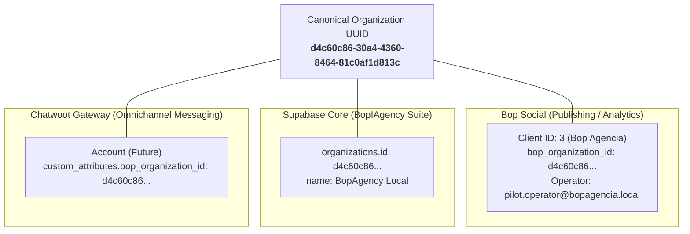

# Bop Agencia — Official Pilot Tenant Inventory Record
**Phase BS-3C.2: Canonical Pilot Tenant Provisioning**

---

### 1. Executive Summary

This document establishes the official pilot inventory record for **Bop Agencia** inside Bop Social. Bop Agencia serves as the internal pilot agency tenant for controlled publishing trials, exercising content creation, media preflights, and approval workflows without using production customer assets.

---

### 2. Tenant Identity & System Identifiers

| Property | Value | Architectural Significance |
| :--- | :--- | :--- |
| **Workspace Name** | `Bop Agencia` | Official internal pilot agency workspace |
| **Local Relational PK (`Client.id`)** | `3` | Integer auto-increment PK used for internal joins and routes |
| **Canonical UUID (`bop_organization_id`)** | `d4c60c86-30a4-4360-8464-81c0af1d813c` | System-wide immutable UUIDv4 correlated with Bop Universe |
| **Agency Entity PK (`Agency.id`)** | `2` | Associated agency organization record |
| **Agency Slug** | `bop-agencia` | Unique URL-safe identifier for agency profile |
| **Workspace Type** | `agency_owned` | Full agency workspace with multi-member capabilities |
| **Subscription Plan** | `agency_managed` | Enterprise-tier agency governance |
| **Creation Timestamp** | `2026-10-15 18:03:37 UTC` | Formally provisioned in Phase BS-3C.2 |

---

### 3. Localization & Regional Defaults

- **Default Language**: `es` (Spanish) — Primary interface locale for Bop Agencia operations.
- **Default Currency**: `USD` (US Dollars) — Standard currency for commercial campaigns, CTWA attribution, and ROI metrics.
- **Timezone**: `America/New_York` (IANA) — Aligned with Eastern US operational target market; all schedules stored in UTC and displayed in local time.

---

### 4. Governance & Approval Policy

- **Content Approval Workflow (`requires_approval`)**: `ENABLED` (`True`)
- **Workflow State Progression**:
  $$\text{Draft} \longrightarrow \text{Pending Approval} \longrightarrow \text{Approved} \longrightarrow \text{Scheduled / Published}$$
- **Rejection Flow**: If rejected by reviewer, state transitions to `rejected` with rejection notes. Posts cannot be dispatched while in `pending_approval` or `rejected` state.

---

### 5. Authorized Internal Operator Account

- **Operator Username / Email**: `pilot.operator@bopagencia.local`
- **User Primary Key (`auth_user.id`)**: `5`
- **Assigned Role**: `client` (with `account_type = 'agency_member'`)
- **Agency Membership**: `owner` in `social_stats_agencymembership` (ID `2`)
- **Default Workspace**: `Client.id = 3` (`Bop Agencia`)
- **Primary Agency**: `Agency.id = 2` (`Bop Agencia`)
- **Operator Language Preference**: `es`
- **Terms of Service**: Accepted (`terms_accepted = True`)
- **Password Security**: Provisioned with high-entropy compliant credentials satisfying Django `PasswordComplexityValidator` (no raw secret stored in repository).

---

### 6. Pilot Data Cleanliness Audit

Direct verification confirms Bop Agencia was provisioned as a pristine workspace:

| Asset / Entity | Count in Tenant (Client 3) | Target State | Status |
| :--- | :---: | :---: | :---: |
| **Platform Credentials (`PlatformCredential`)** | `0` | `0` | **PASS / CLEAN** |
| **Connected Social Accounts** | `0` | `0` | **PASS / CLEAN** |
| **Posts (`UnifiedPost` / `CalendarPost`)** | `0` | `0` | **PASS / CLEAN** |
| **WhatsApp Contacts (`WhatsAppContact`)** | `0` | `0` | **PASS / CLEAN** |
| **CTWA Campaigns (`CTWACampaign`)** | `0` | `0` | **PASS / CLEAN** |
| **External Provider IDs** | `0` | `0` | **PASS / CLEAN** |

---

### 7. Upstream Demo Data Isolation

Pre-existing evaluation fixtures remain completely untouched in PostgreSQL:
- **`Demo User`** (`Client.id = 1`, `bop_organization_id = fb5001ad-0872-4549-9242-e3c32d2f2010`) — Intact.
- **`Demo Agency`** (`Client.id = 2`, `bop_organization_id = 7a4f0fc5-696d-4365-b32b-cf2116bb0e56`) — Intact.
- Cross-tenant API queries confirm complete isolation between Bop Agencia and Demo Agency accounts.

---

### 8. Cross-Application Canonical Architecture

---

### 9. Current Pilot Stage & Next Target

- **Current Stage**: **BS-3C.2 Complete** (Tenant provisioned and verified).
- **Next Planned Action**: **Phase BS-3C.3** (Controlled staging Facebook Page connection and first real text-only post).
- **Target Publishing Asset**: Dedicated internal Bop Agencia staging Facebook Page.
- **Constraints**:
  - Zero live publishing executed in this phase.
  - Zero third-party OAuth connections initiated.
  - S3 credentials remain unconfigured; text-only publishing path selected for initial verification.
