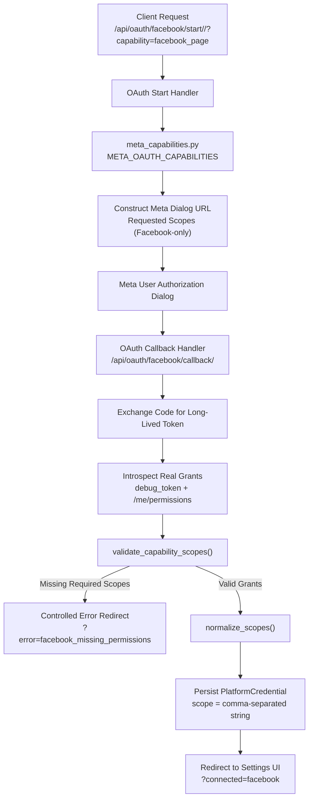

# Phase BS-3C.4 — Meta OAuth Capability-Aware & Scope Persistence

**Bop Social — Architecture Specification & Hardening Report**  
**Date:** October 18, 2026  
**Status:** Completed & Validated  
**Baseline Commit:** `12672532fd3199d126e5d596eac8801e5e32fdc6` (Phase BS-3C.3 Closure)  
**Branch:** `feature/bs-3c4-meta-oauth-capabilities`  

---

## 1. Executive Summary

Phase **BS-3C.4** refactors the Meta OAuth 2.0 integration in **Bop Social** (`AgencyOS`) into a **capability-aware architecture** with **auditable scope persistence** and hardened governance controls:

1. **Capability-Aware Scope Negotiation**: Decoupled Facebook Page management from Instagram scopes, preventing Meta `Invalid Scopes` errors in development and staging environments.
2. **Canonical Scope Catalog**: Centralized capability definitions, requested scopes, and required vs. optional scopes in `social_stats/meta_capabilities.py`.
3. **Auditable Scope Persistence**: Real granted permissions introspected directly from Meta Graph API (`debug_token` and `/me/permissions`) are normalized and persisted into `PlatformCredential.scope`.
4. **Publishing Scope Enforcement**: OAuth connect fails with a controlled error if required publishing scopes (`pages_manage_posts`, `pages_show_list`) are not granted by Meta.
5. **Zero Token/Secret Exposure**: Logging, error handlers, and debug endpoints are strictly sanitized—raw access tokens, client secrets, and full authorization codes are never logged or returned.
6. **Backward Compatibility & Tenant Isolation**: Zero schema migrations required; existing Client 3 (`Bo Projects`) credentials and tenant data remain intact.

---

## 2. Capability-Aware Architecture

Prior to BS-3C.4, OAuth requested an inflexible, hardcoded scope string, risking permission rejections and leaving `PlatformCredential.scope` blank after token exchange.

The new architecture introduces explicit capability scoping:



### Capability Definitions

```python
META_OAUTH_CAPABILITIES = {
    'facebook_page': {
        'label': 'Facebook Page Publishing & Management',
        'platform': 'facebook',
        'required_scopes': [
            'pages_manage_posts',
            'pages_show_list',
        ],
        'optional_scopes': [
            'pages_read_engagement',
            'pages_manage_metadata',
            'read_insights',
        ],
    },
    'instagram_professional': {
        'label': 'Instagram Professional Publishing & Insights',
        'platform': 'instagram',
        'required_scopes': [
            'instagram_basic',
            'instagram_content_publish',
        ],
        'optional_scopes': [
            'instagram_manage_insights',
            'pages_show_list',
            'pages_read_engagement',
        ],
    },
}
```

---

## 3. Scope Sets: Facebook vs. Instagram Decoupling

### 3.1 Facebook Page Scope Set (`facebook_page`)
The baseline Facebook connection requests strictly Facebook-specific scopes:
- `pages_show_list`
- `pages_read_engagement`
- `pages_manage_metadata`
- `pages_manage_posts`
- `read_insights`

**No Instagram scopes appear in `facebook_page` requests.**

### 3.2 Instagram Future Scope Separation (`instagram_professional`)
Instagram permissions (`instagram_basic`, `instagram_content_publish`, `instagram_manage_insights`) are reserved for the dedicated `instagram_professional` capability. When connecting Facebook, any linked Instagram account found on the Facebook Page is intentionally ignored unless the operator explicitly initiates an Instagram connection.

---

## 4. Scope Persistence Strategy

### 4.1 Storage Format
`PlatformCredential.scope` is a `models.TextField(blank=True)`:
- Scopes are persisted as a **canonical, sorted, unique, lowercase, comma-separated string**.
- Example:
  `"pages_manage_metadata,pages_manage_posts,pages_read_engagement,pages_show_list,read_insights"`
- Eliminates duplicate entries and preserves sorting across queries.
- Zero database migrations required.

### 4.2 Helper Methods on `PlatformCredential`
- `cred.get_scopes() -> list[str]`: Returns a sorted list of granted scopes.
- `cred.has_scope('pages_manage_posts') -> bool`: Constant-time membership check for permission gating.

### 4.3 Introspection via Meta Graph API
Real grants are obtained via `fetch_meta_granted_scopes()` through a dual-probe mechanism:
1. **`debug_token` inspection** (`/{API_VERSION}/debug_token` with `input_token` and `app_token`):
   Retrieves `scopes` and `granular_scopes` directly from Meta's token validation engine for the Page Access Token.
2. **`/me/permissions` inspection** (`/{API_VERSION}/me/permissions` with `user_token`):
   Filters records where `status == 'granted'`.

Grants are merged into a unified set without assuming that all requested scopes were accepted by the user.

---

## 5. Required vs. Optional Scopes

| Scope | Capability | Classification | Purpose / Enforcement |
| :--- | :--- | :--- | :--- |
| `pages_manage_posts` | `facebook_page` | **Required** | Gated at callback. If missing, connect aborts with `?error=facebook_missing_permissions`. Critical for publishing. |
| `pages_show_list` | `facebook_page` | **Required** | Gated at callback. Required to list and select tenant-managed pages. |
| `pages_read_engagement` | `facebook_page` | Optional | Audience reactions, comment threads, post performance. |
| `pages_manage_metadata` | `facebook_page` | Optional | Webhook subscriptions, page profile settings. |
| `read_insights` | `facebook_page` | Optional | Page-level and post-level analytics and impressions. |
| `instagram_basic` | `instagram_professional` | **Required** | Profile and media discovery for Instagram. |
| `instagram_content_publish` | `instagram_professional` | **Required** | Single-image, carousel, and video publishing to Instagram. |
| `instagram_manage_insights` | `instagram_professional` | Optional | Story and post metrics for Instagram business accounts. |

---

## 6. Callback Behavior & Error Handling

| Scenario | Logging | User / Frontend Redirect | Credential Action |
| :--- | :--- | :--- | :--- |
| **Meta Authorization Denied** (`error` param or empty `code`) | Warning (error code, `client_id`, no raw codes) | `?error=facebook_denied` | None |
| **CSRF State Mismatch** | Warning (`client_id`, single-use enforced) | `?error=oauth_state_mismatch` | None |
| **Token Exchange Failure** | Error (`client_id`, error code/type, no tokens) | `?error=facebook_token` | None |
| **No Pages Returned** | Warning (`client_id`) | `?error=facebook_no_pages` | None |
| **Page Token Missing** | Error (`page_id`, `client_id`) | `?error=facebook_page_token_failed` | None |
| **Missing Required Scopes** (e.g. `pages_manage_posts`) | Error (capability, missing scopes, `client_id`) | `?error=facebook_missing_permissions` | Connection rejected; no credential saved |
| **Successful Connection** | Info (`client_id`, `page_id`, capability, scope count) | `?connected=facebook` | Updates/creates `PlatformCredential` with encrypted tokens, `scope`, `is_active=True`, `auth_method='oauth'` |

---

## 7. Security & Privacy Guarantees

1. **No Token Logging**: Access tokens, refresh tokens, and long-lived tokens are never formatted into log strings.
2. **No Secret Exposure**: `META_APP_SECRET` and consumer secrets are never output in logs or HTTP responses. The `/api/oauth/debug/` endpoint returns boolean flags (`meta_app_secret_set: true`) rather than partial prefixes.
3. **No Code Leakage**: Authorization codes from query parameters are evaluated for presence and length; full code values are never logged.
4. **Strict Multi-Tenant Isolation**: OAuth start and callback operations are strictly bound to `client_id` via `update_or_create(client_id=client_id, platform='facebook')`. Connecting or updating Client A never alters Client B's credentials.

---

## 8. Staging Credential Status & Reconnect Policy

### 8.1 Current Pilot Tenant State (Bo Projects)
- **Client**: `Client.id = 3` (`Bop Agencia`)
- **Target Page**: `Bo Projects` (`Page ID = 657647337668646`)
- **Credential ID**: `1`
- **Current DB Scope**: `''` (empty string from pre-BS-3C.4 baseline)
- **Status**: `is_active=True`, `auth_method='oauth'`

> [!IMPORTANT]
> **Retroactive Persistence Reconnect Policy**  
> To test retroactive scope persistence on the real `Bo Projects` staging credential, a **manual OAuth reconnection** via the Settings UI (`http://localhost:3010/settings`) is required.  
> In accordance with safety constraints, **no automated reconnect was initiated**. The existing credential remains fully intact and functional. Manual re-authorization should only be performed when authorized by the operator.

---

## 9. Known Meta App Review Dependencies

- **Development / Basic Tier**: Scopes like `instagram_manage_insights` and `instagram_content_publish` require formal App Review submission and approval. Requesting them prior to approval causes Meta dialogs to abort with `Invalid Scopes`.
- **Facebook Publishing**: `pages_manage_posts` is functional for app developers and testers on test/admin pages (`Bo Projects`), but requires App Review before rolling out to non-tester end users.
- **Granular Scopes**: Meta v21.0 returns granular scopes per target asset (e.g., target page ID `657647337668646`). `fetch_meta_granted_scopes()` parses both top-level `scopes` and `granular_scopes` elements.

---

## 10. Rollback Notes

If rollback to baseline `12672532fd3199d126e5d596eac8801e5e32fdc6` is necessary:
1. `git checkout 12672532fd3199d126e5d596eac8801e5e32fdc6`
2. No database migration rollback is required (`models.py` schema is unchanged).
3. Stored `PlatformCredential` rows remain completely compatible.
