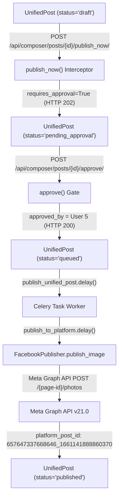

# Phase BS-3C.5 — Facebook Media Pilot: Formal Closure

**Bop Social — S3 Media Pipeline, Presigned HTTPS Delivery & Controlled Facebook Publishing Pilot Closure**

---

## 1. Executive Summary

Phase **BS-3C.5** (including operational stages BS-3C.5A through BS-3C.5F) achieved the first end-to-end controlled real social media media/image publication from **Bop Social** through the **Meta Graph API** to a live Facebook Page (**Bo Projects**).

The end-to-end pipeline was executed cleanly under strict internal governance protocols without impacting any production customer assets:
$$\text{Media Upload (S3 Direct)} \longrightarrow \text{Presigned HTTPS Engine} \longrightarrow \text{Composer Post Draft} \longrightarrow \text{Submission (202)} \longrightarrow \text{Approval Gate (200)} \longrightarrow \text{Celery Dispatch} \longrightarrow \text{FacebookPublisher} \longrightarrow \text{Meta Graph API} \longrightarrow \text{Bo Projects Page}$$

The image asset was uploaded into private S3 storage (`bopsocial-staging-media`), signed via SigV4 presigned URL, and consumed by Meta's photo ingestion endpoint. The post was published to Facebook, logged with platform confirmation ID `657647337668646_1661141888860370`, marked `published` with zero errors, and verified live on Meta's infrastructure.

---

## 2. Pilot Tenant & Entity Mapping

All actions were strictly bounded within the authorized internal pilot tenant (`Client.id = 3`):

| Entity / Dimension | Value | Architectural Significance |
| :--- | :--- | :--- |
| **Workspace Tenant** | `Bop Agencia` | Official internal pilot tenant |
| **Local Relational PK (`Client.id`)** | `3` | Scoped multi-tenant execution boundary |
| **Canonical UUID (`bop_organization_id`)** | `d4c60c86-30a4-4360-8464-81c0af1d813c` | Canonical Bop Universe correlation key |
| **Associated Agency (`Agency.id`)** | `2` (`bop-agencia`) | Internal agency management entity |
| **Pilot Operator User** | `pilot.operator@bopagencia.local` | Authorized internal operator (User ID `5`) |
| **Target Facebook Page** | `Bo Projects` | Dedicated internal staging Facebook Page |
| **Meta Page ID** | `657647337668646` | Dedicated staging asset |
| **PlatformCredential ID** | `1` | `client_id=3`, `platform='facebook'`, `is_active=True`, `auth_method='oauth'` |
| **PlatformCredential Scopes** | `pages_manage_posts`, `pages_show_list` | Granular OAuth scopes persisted in BS-3C.4/4A |

---

## 3. MediaAsset & S3 Storage Architecture

### 3.1 MediaAsset Metadata
- **MediaAsset ID**: `1`
- **Client ID**: `3` (`Bop Agencia`)
- **Original Filename**: `bopsocial1.png`
- **Main S3 Key**: `media_assets/tenant_3/2026/10/bopsocial1_104b4d6d.png`
- **Thumbnail S3 Key**: `media_assets/thumbs/tenant_3/2026/10/bopsocial1_104b4d6d_thumb.jpg`
- **MIME Type**: `image/png`
- **Content-Length**: `1,796,137` bytes (~1.71 MB)
- **SHA-256 Digest**: `b3e2ee1e178262aaa1ce2029ded11b5a76a13512bb2f56e68af1c0ebac6993d3`
- **Hash Verification**: Matches original operator-authorized file bit-for-bit.

### 3.2 Private S3 Storage Architecture
- **Bucket**: `bopsocial-staging-media`
- **Region**: `us-east-2`
- **Access Policy**: Private bucket with **Block Public Access** enabled.
- **Access Control**: Zero public ACLs; no `public-read` grants.
- **Multi-Tenant Partitioning**: Strict key isolation under `media_assets/tenant_{client_id}/%Y/%m/{filename}`.

### 3.3 Minimal IAM Permissions
Media delivery and lifecycle management operate under least-privilege IAM permissions:
- **Object-Level Actions**:
  - `s3:PutObject`
  - `s3:GetObject`
  - `s3:DeleteObject`
- **Resource ARN**: `arn:aws:s3:::bopsocial-staging-media/media_assets/*`
- **Excluded Operations**:
  - `s3:ListBucket` is NOT required.
  - `s3:PutObjectAcl` is NOT required.
  - `s3:GetBucketLocation` / `HeadBucket` is NOT required for media delivery.

### 3.4 Presigned HTTPS Delivery Engine
Meta requires publicly accessible HTTPS URLs to ingest photo assets (`/{page-id}/photos?url=...&caption=...`).
1. `media_service.get_provider_media_url(asset, 'facebook')` detects that S3 is enabled.
2. It generates a signed SigV4 HTTPS URL (`https://bopsocial-staging-media.s3.amazonaws.com/...`) with a 3600-second (1 hour) TTL.
3. Meta servers fetch the file directly over HTTPS with HTTP 200 response and correct `image/png` header without requiring Bop Social authentication headers or exposing the S3 bucket publicly.

---

## 4. Canonical Approval & Publishing Workflow

For workspaces with content governance enabled (`requires_approval = True`), Bop Social enforces a mandatory two-step gate before any post can be scheduled or dispatched to Celery:



### 4.1 Step 1 — Submission (`publish_now`)
- **Endpoint**: `POST /api/composer/posts/{id}/publish_now/`
- **Behavior**: When `client.requires_approval = True`, the view checks `not post.approved_by_id`.
- **State Transition**: `draft` $\longrightarrow$ `pending_approval`.
- **Response**: `HTTP 202 Accepted` (`{"detail": "Post requires approval before publishing.", "status": "pending_approval"}`).
- **Safety**: Does NOT call Meta Graph API, does NOT create `PlatformPublishLog`, and does NOT publish to social platforms. Enqueues only `notify_approver_for_post`.

### 4.2 Step 2 — Approval Gate (`approve`)
- **Endpoint**: `POST /api/composer/posts/{id}/approve/`
- **Strict Invariant**: Enforces `if post.status != 'pending_approval': return Response({'detail': 'Post is not pending approval'}, status=400)`.
- **Important**: Calling `approve` on a post in `draft` status is strictly rejected by the backend. The submission step (`publish_now`) must precede `approve`.
- **State Transition**: `pending_approval` $\longrightarrow$ `queued`.
- **Audit Fields Set**: `approved_by = User 5`, `approved_at = timezone.now()`.
- **Celery Dispatch**: Dispatches `publish_unified_post.delay(post.id)`.

---

## 5. Execution Timestamps & Evidence

| Stage / Event | Timestamp (UTC) | Record / Status |
| :--- | :--- | :--- |
| **S3 Media Persisted** | `2026-10-18 20:30:15` | `MediaAsset.id = 1` uploaded and verified in S3 |
| **Post Draft Assembled** | `2026-10-18 23:05:11` | `UnifiedPost.id = 2` created in `draft` state |
| **Provider Media URL Verified** | `2026-10-18 23:05:19` | Anonymous GET returned HTTP 200, Content-Type: `image/png` |
| **Preflight Check** | `2026-10-18 23:25:33` | `/api/composer/preflight/` returned `ok = True` |
| **Submission Step (`publish_now`)** | `2026-10-19 04:26:15` | `HTTP 202`, transitioned `draft` $\to$ `pending_approval` |
| **Approval Step (`approve`)** | `2026-10-19 04:26:59` | `HTTP 200`, `approved_by_id = 5`, transition `pending_approval` $\to$ `queued` |
| **Celery Dispatch Attempt** | `2026-10-19 04:26:59` | `PlatformPublishLog.attempted_at` |
| **Meta Graph API Delivery** | `2026-10-19 04:27:04` | `PlatformPublishLog.completed_at` (duration: ~5.6s) |
| **Final Post Status** | `published` | `UnifiedPost.status = 'published'`, `error_message = ''` |

---

## 6. Publishing Verification Output

- **UnifiedPost ID**: `2`
- **Title**: `Bop Social Facebook Media Pilot #1`
- **Content**:
  ```text
  Bop Social Facebook Media Pilot #1

  Publicación de prueba interna con imagen desde Bop Social.
  ```
- **Target Platform**: `['facebook']`
- **Media Asset**: `MediaAsset.id = 1` (`bopsocial1.png`)
- **PlatformPublishLog ID**: `2`
- **Status**: `success`
- **Platform Post ID**: `657647337668646_1661141888860370`
- **Platform URL**: [https://www.facebook.com/657647337668646_1661141888860370](https://www.facebook.com/657647337668646_1661141888860370)
- **Error Code / Message**: None (empty strings)

---

## 7. Security & Multi-Tenant Invariants

1. **Tenant Isolation**: S3 objects are isolated under `media_assets/tenant_{client_id}/`. Client 3 assets cannot be addressed or modified by other tenants.
2. **Credential Scoping**: `PlatformCredential.id = 1` is strictly associated with `client_id = 3` and Meta Page `657647337668646`.
3. **Single Target**: The media post targeted exclusively Facebook. Instagram, LinkedIn, and other platforms were not contacted.
4. **Credential & Secret Protection**: No API tokens, App Secrets, or AWS secret keys are stored in the codebase or logged in documentation. Presigned URL query parameters (SigV4 signatures) are redacted.
5. **Private Storage**: S3 bucket `bopsocial-staging-media` remains 100% private with public access blocked; media delivery relies entirely on temporary expiring presigned URLs.
6. **No Duplicate Execution**: All preflights, submission, and approval gates enforced single-call execution, resulting in exactly one publish log and zero orphaned background jobs.

---

## 8. Lessons Learned & Technical Hardening

1. **Django AWS Settings Bridge**: In Docker environments, environment variables passed to the container must be bridged into Django's `django.conf.settings` (e.g. `getattr(settings, 'AWS_STORAGE_BUCKET_NAME', ...)`), ensuring storage helpers and credential validators resolve correctly.
2. **Direct S3 Persistence in Media Pipeline**: Default Django `FileSystemStorage` saves files only to the local container filesystem. The Bop Social media service was hardened so `upload_media()` writes directly to S3 when S3 is enabled.
3. **Two-Step Approval Gate Dependency**: `UnifiedPostViewSet.approve()` strictly requires `status == 'pending_approval'`. A draft cannot be approved directly; calling `publish_now` first moves the post to `pending_approval` when `requires_approval = True`.
4. **Presigned URL Viability for Social Ingestion**: Meta Graph API successfully accepts temporary S3 presigned URLs for photo uploads without requiring persistent public S3 read permissions.
5. **IAM Least Privilege**: Media uploads and presigned delivery require only `s3:PutObject`, `s3:GetObject`, and `s3:DeleteObject`. Bucket-level actions like `s3:ListBucket` are completely unnecessary and should remain disallowed.

---

## 9. Baseline Approved DB State

| Table / Model | Baseline Count | Distribution / Notes |
| :--- | :---: | :--- |
| **`UnifiedPost`** | `2` | Post #1 (historical text pilot, published) + Post #2 (media pilot, published) |
| **`PlatformPublishLog`** | `2` | Log #1 (Post #1, success) + Log #2 (Post #2, success) |
| **`MediaAsset`** | `1` | Asset #1 (`bopsocial1.png`, client 3, preserved in S3) |
| **`PlatformCredential`** | `1` | Credential #1 (Client 3, Bo Projects, active, OAuth scopes verified) |
