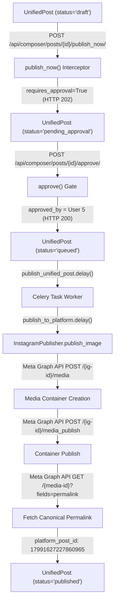

# Phase BS-3D — Instagram Professional Publishing Pilot: Formal Closure

**Bop Social — Instagram Professional Account Linkage, S3 JPEG Media Pipeline & Controlled Live Publication Pilot Closure**

---

## 1. Executive Summary

Phase **BS-3D** (encompassing operational stages BS-3D.1 through BS-3D.6A) achieved the first end-to-end controlled real social media publication from **Bop Social** through the **Meta Graph API** to a live Instagram Professional account (**@bopsoluciones** / ID `17841464843082253`).

The end-to-end pipeline was executed cleanly under strict internal governance protocols without impacting any production customer assets:
$$\text{OAuth Linkage (Client 3)} \longrightarrow \text{S3 JPEG Pipeline} \longrightarrow \text{Composer Draft Post} \longrightarrow \text{Submission (202)} \longrightarrow \text{Approval Gate (200)} \longrightarrow \text{Celery Dispatch} \longrightarrow \text{InstagramPublisher} \longrightarrow \text{Meta Graph API} \longrightarrow \text{@bopsoluciones}$$

The JPEG image asset was created, uploaded into private S3 storage (`bopsocial-staging-media`), signed via SigV4 presigned URL, and consumed by Meta's Instagram container endpoints. The post was published to Instagram, logged with platform confirmation ID `17991627227860965`, marked `published` with zero errors, and verified live on Meta's infrastructure with canonical permalink `https://www.instagram.com/p/Derx_mjEb62/`.

---

## 2. Pilot Tenant & Entity Mapping

All actions were strictly bounded within the authorized internal pilot tenant (`Client.id = 3`):

| Entity / Dimension | Value | Architectural Significance |
| :--- | :--- | :--- |
| **Workspace Tenant** | `Bop Agencia` | Official internal pilot tenant |
| **Local Relational PK (`Client.id`)** | `3` | Scoped multi-tenant execution boundary |
| **Canonical UUID (`bop_organization_id`)** | `d4c60c86-30a4-4360-8464-81c0af1d813c` | Canonical Bop Universe correlation key |
| **Associated Agency (`Agency.id`)** | `2` (`bop-agencia`) | Internal agency management entity |
| **Pilot Operator User** | `pilot.operator@bopagencia.local` | Authorized internal operator (User ID `5`) |
| **Linked Facebook Page** | `Bo Projects` (ID `657647337668646`) | Dedicated staging Facebook Page |
| **Target Instagram Professional Account** | `@bopsoluciones` | Business account linked to `Bo Projects` |
| **Instagram Account ID** | `17841464843082253` | Meta Graph API Professional ID |
| **PlatformCredential ID** | `2` | `client_id=3`, `platform='instagram'`, `is_active=True`, `auth_method='oauth'` |
| **PlatformCredential Scopes** | `instagram_basic`, `instagram_content_publish`, `pages_show_list`, `business_management`, `pages_read_engagement` | Granular OAuth scopes persisted in BS-3D.2 |

---

## 3. MediaAsset & S3 Storage Architecture

### 3.1 MediaAsset Metadata
- **MediaAsset ID**: `2`
- **Client ID**: `3` (`Bop Agencia`)
- **Original Filename**: `bopsocial2.jpg`
- **Main S3 Key**: `media_assets/tenant_3/2026/10/bopsocial2_b3a28059.jpg`
- **Thumbnail S3 Key**: `media_assets/thumbs/tenant_3/2026/10/bopsocial2_b3a28059_thumb.jpg`
- **MIME Type**: `image/jpeg`
- **Content-Length**: `352,103` bytes (~343.85 KB)
- **Dimensions**: `1254 x 1254 px` (Aspect Ratio: `1.00`)
- **SHA-256 Digest**: `292318a1f2bd781c6915b1435503ce88c9701ce0480526dc77fe6a3e6530c9a0`
- **Hash Verification**: Matches original operator-authorized file bit-for-bit.

### 3.2 Private S3 Storage Architecture
- **Bucket**: `bopsocial-staging-media`
- **Region**: `us-east-2`
- **Access Policy**: Private bucket with **Block Public Access** enabled.
- **Access Control**: Zero public ACLs; no `public-read` grants.
- **Multi-Tenant Partitioning**: Strict key isolation under `media_assets/tenant_{client_id}/%Y/%m/{filename}`.

---

## 4. Canonical Approval & Publishing Workflow

For workspaces with content governance enabled (`requires_approval = True`), Bop Social enforces a mandatory two-step gate before any post can be scheduled or dispatched to Celery:



### 4.1 Step 1 — Submission (`publish_now`)
- **Endpoint**: `POST /api/composer/posts/{id}/publish_now/`
- **Behavior**: When `client.requires_approval = True`, the view checks `not post.approved_by_id`.
- **State Transition**: `draft` $\longrightarrow$ `pending_approval`.
- **Response**: `HTTP 202 Accepted` (`{"detail": "Post requires approval before publishing.", "status": "pending_approval"}`).
- **Safety**: Does NOT call Meta Graph API, does NOT create `PlatformPublishLog`, and does NOT publish to social platforms. Enqueues only `notify_approver_for_post`.

### 4.2 Step 2 — Approval Gate (`approve`)
- **Endpoint**: `POST /api/composer/posts/{id}/approve/`
- **Strict Invariant**: Enforces `if post.status != 'pending_approval': return Response({'detail': 'Post is not pending approval'}, status=400)`.
- **State Transition**: `pending_approval` $\longrightarrow$ `queued`.
- **Audit Fields Set**: `approved_by = User 5`, `approved_at = timezone.now()`.
- **Celery Dispatch**: Dispatches `publish_unified_post.delay(post.id)`.

---

## 5. Live Publication Verification

- **UnifiedPost ID**: `3`
- **Title**: `Bop Social Instagram Media Pilot #1`
- **Content**:
  ```text
  Bop Social Instagram Media Pilot #1

  Publicación de prueba interna con imagen desde Bop Social.
  ```
- **Target Platform**: `['instagram']`
- **Media Asset**: `MediaAsset.id = 2` (`bopsocial2.jpg`)
- **PlatformPublishLog ID**: `3`
- **Status**: `success`
- **Platform Post ID**: `17991627227860965`
- **Live URL**: [https://www.instagram.com/p/Derx_mjEb62/](https://www.instagram.com/p/Derx_mjEb62/)
- **Error Code / Message**: None (empty strings)

---

## 6. Permalink Resolution Bug & Remediation (BS-3D.6 / BS-3D.6A)

### 6.1 Bug Identification
During the post-publish audit (BS-3D.6), inspecting `PlatformPublishLog.platform_url` revealed a synthetic URL:
$$\text{Synthesized URL: } \texttt{https://www.instagram.com/p/17991627227860965}$$

Meta Graph API returns a numeric database Media ID (`17991627227860965`), whereas Instagram public web routing `/p/{shortcode}/` requires an alphanumeric shortcode (`Derx_mjEb62`). Concatenating the raw Media ID into `/p/{media_id}` generated an invalid link that failed to resolve in browsers.

### 6.2 Architectural Fix
In `backend/social_stats/publishers/instagram.py` (`_publish_container`), the publisher was updated to immediately query the canonical permalink upon publication:
```python
permalink = None
try:
    permalink_res = client.get(
        f'/{media_id}',
        params={'fields': 'permalink'},
    )
    permalink = (permalink_res.get('permalink') or '').strip()
except Exception as exc:
    logger.warning(
        'Instagram post published (media_id=%s) but permalink lookup failed: %s: %s',
        media_id, exc.__class__.__name__, str(exc)[:200],
    )
    permalink = ''

return PublishResult(
    success=True,
    platform_post_id=str(media_id),
    platform_url=permalink or '',
    raw_response=body,
)
```

### 6.3 Resilient Fallback Policy
1. **Never Fail Published Posts**: If the follow-up permalink GET fails (due to transient network timeouts or rate limits), the post remains successfully published (`success=True`, `platform_post_id=media_id`).
2. **Never Synthesize Broken URLs**: If lookup fails, `platform_url` is left empty (`''`), avoiding misleading broken links in the user interface.
3. **Audit Logging**: A sanitized warning is logged containing only the `media_id` and error class, never exposing access tokens or request signatures.

### 6.4 Historical Log Remediation
The historical log `PlatformPublishLog.id = 3` was updated via an idempotent database operation:
```sql
UPDATE social_stats_platformpublishlog
SET platform_url = 'https://www.instagram.com/p/Derx_mjEb62/'
WHERE id = 3;
```

---

## 7. Baseline Approved DB State

| Table / Model | Baseline Count | Distribution / Notes |
| :--- | :---: | :--- |
| **`UnifiedPost`** | `3` | Post #1 (FB text) + Post #2 (FB media) + Post #3 (IG media) |
| **`PlatformPublishLog`** | `3` | Log #1 (Post #1, success) + Log #2 (Post #2, success) + Log #3 (Post #3, success) |
| **`MediaAsset`** | `2` | Asset #1 (`bopsocial1.png`, PNG) + Asset #2 (`bopsocial2.jpg`, JPEG) |
| **`PlatformCredential`** | `2` | Credential #1 (Facebook `Bo Projects`) + Credential #2 (Instagram `@bopsoluciones`) |
