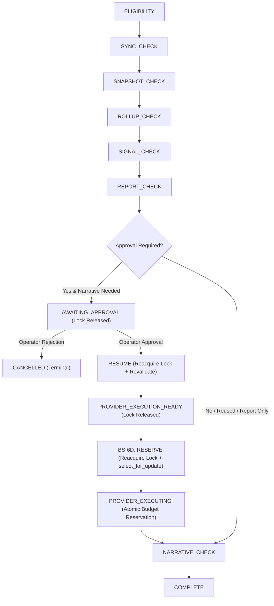

# BS-6 Production Intelligence Automation Architecture

## 1. Overview & Purpose

Phase **BS-6** establishes the production automation and deterministic scheduling foundation for BOP Social's multichannel intelligence pipeline.

Following Phase BS-5 (which proved manual, controlled operator execution of multi-platform rollups, cross-platform business signals, executive reporting, and grounded AI executive narratives), BS-6 constructs the orchestration and safety architecture required for scheduled, multi-tenant intelligence generation without prematurely activating autonomous recurring generation.

The intelligence pipeline follows a deterministic chain of progression:
```
Provider Sync ──► Metric Snapshots ──► Metric Rollups ──► Business Signals ──► Executive Report ──► Grounded Executive Narrative
```

Every stage in BS-6 is independently gated, strictly audited, tenant-isolated, idempotent, fail-closed, and safe against concurrent duplicate execution.

---

## 2. Core Architectural Invariants

1. **Explicit Tenant Unit**: Automation never executes globally without tenant enumeration. An automation unit is strictly defined as:
   $$\text{Automation Unit} = \text{Tenant (Client)} + \text{Reporting Period} + \text{Pipeline Version}$$
2. **Deterministic Execution Identity**: Every run derives its deduplication key via a SHA-256 digest of `client_id`, `period_start`, `period_end`, and `pipeline_version`.
3. **Database Unique Constraints**: Database-level unique constraints on active execution identities prevent duplicate inflight executions across distributed workers, covering all active states: `['PENDING', 'ELIGIBILITY_CHECK', 'RUNNING', 'AWAITING_APPROVAL', 'PROVIDER_EXECUTION_READY', 'PROVIDER_EXECUTING']`.
4. **PostgreSQL Advisory Single-Flight Locking**: Fast, lightweight distributed mutual exclusion is maintained using PostgreSQL session advisory locks derived deterministically from the execution identity. Advisory locks are strictly released when pausing for human approval and when parked in execution-ready state.
5. **Fail-Closed Eligibility**: Any unfulfilled safety invariant (e.g., inactive client, missing active credentials, stale telemetry, disabled config) halts execution cleanly without external provider calls or DB corruption.
6. **Existing Artifact Reuse**: If valid `ExecutiveReport` or `ExecutiveNarrative` records already exist for the requested period, the engine reuses them rather than regenerating or overwriting canonical data.
7. **Strict Provider Budget Enforcement**: Provider call budgets are strictly enforced (`budget = 1` by default, `0` in dry-run mode). Live LLM or social API calls are disallowed if the budget is exhausted.
8. **Pure Dry-Run Preview Mode**: Dry-run mode (`dry_run=True`) performs zero database mutations (no config edits, no run records, no report/narrative generation) and zero provider network calls, producing a comprehensive execution plan and diagnostic explanation.
9. **Observability Without Secret Leaking**: All audit events use structured JSON with automatic redaction of bearer tokens, client secrets, passwords, and private API keys.
10. **Disabled-by-Default Scheduler**: Recurring Celery Beat periodic tasks are registered as unscheduled/disabled until full production approval.
11. **Run-Level Approval Workflow (BS-6C)**: When operator approval is required before live narrative generation, the run transitions cleanly to `AWAITING_APPROVAL`, calculates a cryptographically frozen `approval_token`, releases session advisory locks, and halts before any external provider call. Resuming requires explicit operator decision, lock reacquisition, and complete safety revalidation.
12. **Provider Boundary & Execution-Ready State Contract (BS-6C.0A)**: Resumed runs reaching the provider boundary persist `status='PROVIDER_EXECUTION_READY'`. This state is fully protected under the database unique constraint and scheduler scanner, preventing duplicate enqueues across all 96 daily ticks. Live execution requires atomic reservation via `PROVIDER_EXECUTING` under single-flight locking, enforcing at-most-once semantics and fail-closed crash recovery.

---

## 3. Data Models

### 3.1 `IntelligenceAutomationConfig`

Tenant-level configuration governing pipeline scheduling, freshness thresholds, and safety limits.

| Field | Type | Default | Description |
|---|---|---|---|
| `client` | `OneToOneField(Client)` | Required | Foreign key to tenant client |
| `enabled` | `BooleanField` | `False` | Master switch for tenant automation |
| `timezone` | `CharField(64)` | `'America/New_York'` | Tenant timezone name |
| `reporting_frequency` | `CharField(20)` | `'MONTHLY'` | Schedule cadence (`MONTHLY`, `WEEKLY`, `CUSTOM`) |
| `reporting_day` | `PositiveSmallIntegerField` | `1` | Day of month (1-28) or weekday (0=Mon, 6=Sun) |
| `reporting_hour` | `PositiveSmallIntegerField` | `2` | Execution hour in tenant local time (0-23) |
| `lookback_days` | `PositiveIntegerField` | `30` | Data lookback duration |
| `minimum_data_freshness_hours` | `PositiveIntegerField` | `48` | Maximum telemetry staleness before blocking |
| `generate_report` | `BooleanField` | `True` | Whether to generate executive report |
| `generate_narrative` | `BooleanField` | `False` | Whether to generate AI grounded narrative |
| `require_operator_approval` | `BooleanField` | `True` | Enforce human-in-the-loop review |
| `provider_call_budget` | `PositiveIntegerField` | `1` | Max permitted external LLM calls per period |
| `max_retry_count` | `PositiveIntegerField` | `0` | Max automated retry attempts |

### 3.2 `IntelligenceAutomationRun`

Durable orchestration record tracking stage progression, execution identity, audit metadata, approval metadata, and artifact references.

| Field | Type | Description |
|---|---|---|
| `client` | `ForeignKey(Client)` | Associated tenant client |
| `agency_id` | `CharField(64)` | Agency identifier (supports UUIDs and string IDs) |
| `period_start` | `DateField` | Reporting period start boundary |
| `period_end` | `DateField` | Reporting period end boundary |
| `pipeline_version` | `CharField(32)` | Pipeline schema/algorithm version (default: `'bs6a-v1'`) |
| `execution_identity` | `CharField(64)` | SHA-256 hash of `(client_id, period_start, period_end, pipeline_version)` |
| `trigger_type` | `CharField(20)` | `MANUAL`, `SCHEDULED`, `RETRY`, or `ADMIN` |
| `status` | `CharField(30)` | `PENDING`, `ELIGIBILITY_CHECK`, `RUNNING`, `AWAITING_APPROVAL`, `PROVIDER_EXECUTION_READY`, `PROVIDER_EXECUTING`, `BLOCKED`, `FAILED`, `COMPLETED`, `CANCELLED` |
| `current_stage` | `CharField(32)` | Currently executing or evaluated pipeline stage |
| `approval_status` | `CharField(20)` | `NOT_REQUIRED`, `PENDING`, `APPROVED`, `REJECTED` |
| `approval_requested_at`| `DateTimeField` | When the run transitioned to `AWAITING_APPROVAL` |
| `approval_decided_at` | `DateTimeField` | When operator recorded approval or rejection |
| `approved_by` | `ForeignKey(User)` | Operator who authorized or rejected the run |
| `approval_comment_safe`| `TextField` | Sanitized operator comment explaining the decision |
| `approval_token` | `CharField(64)` | SHA-256 identity freeze digest ensuring resume integrity |
| `started_at` | `DateTimeField` | Execution commencement timestamp |
| `finished_at` | `DateTimeField` | Execution conclusion timestamp |
| `requested_by` | `CharField(128)` | Username, task name, or system trigger |
| `dry_run` | `BooleanField` | Whether execution was executed as a dry-run |
| `provider_call_count` | `PositiveIntegerField` | Recorded number of external provider calls |
| `retry_count` | `PositiveIntegerField` | Current retry counter |
| `fallback_count` | `PositiveIntegerField` | Current fallback invocation counter |
| `error_code` | `CharField(64)` | Structured error or block code |
| `error_message_safe` | `TextField` | Sanitized, non-sensitive error explanation |
| `report_id` | `PositiveIntegerField` | ID of generated or reused `ExecutiveReport` |
| `narrative_id` | `PositiveIntegerField` | ID of generated or reused `ExecutiveNarrative` |

#### Unique Constraint (BS-6C.0A)
```python
UniqueConstraint(
    fields=["client", "period_start", "period_end", "pipeline_version"],
    condition=Q(status__in=[
        "PENDING",
        "ELIGIBILITY_CHECK",
        "RUNNING",
        "AWAITING_APPROVAL",
        "PROVIDER_EXECUTION_READY",
        "PROVIDER_EXECUTING",
    ]),
    name="unique_active_intelligence_run",
)
```
This ensures that any run actively executing, awaiting approval, or parked at `PROVIDER_EXECUTION_READY` / `PROVIDER_EXECUTING` maintains database-level uniqueness across distributed workers and periodic scheduler scans.

---

## 4. Pipeline Stages & Approval Lifecycle

The pipeline defines the complete, inspectable execution lifecycle:



---

## 8. Run-Level Approval & Provider Boundary Contract (BS-6C & BS-6C.0A)

### 8.1 Approval Request Point & Lock Release Contract
Narrative stage pauses BEFORE any provider call:
1. When `generate_narrative=True` and `require_operator_approval=True`, `REPORT_CHECK` completes, linking any existing report or preparing report data.
2. The orchestrator transitions run status from `RUNNING` to `AWAITING_APPROVAL` with `approval_status='PENDING'`.
3. An SHA-256 identity freeze token is calculated and stored in `run.approval_token`:
   $$\text{approval\_token} = \text{SHA-256}(\text{run\_id} \mathbin{\Vert} \text{execution\_identity} \mathbin{\Vert} \text{pipeline\_version} \mathbin{\Vert} \text{period\_start} \mathbin{\Vert} \text{period\_end} \mathbin{\Vert} \text{report\_id})$$
4. `provider_call_count` is confirmed `0`.
5. The PostgreSQL session advisory lock is **explicitly released** before returning control. Worker threads and database connections do NOT retain locks while waiting for human input.
6. Execution terminates safely with stage `AWAITING_APPROVAL`. Zero LLM calls occur.

### 8.2 Operator Decision Protocol
An authorized operator or admin user records their decision via CLI (`approve_intelligence_run`), REST API, or Django Admin:
- **Approval (`approve_intelligence_run`)**:
  - Enclosed in an atomic transaction with `select_for_update()`.
  - Verifies run is currently in `AWAITING_APPROVAL` and `approval_status == 'PENDING'`.
  - Verifies operator permission (`is_staff`, `is_superuser`, or valid tenant operator role).
  - Verifies tenant isolation (operators cannot approve runs belonging to unauthorized clients).
  - Transitions `approval_status` to `'APPROVED'`, records `approved_by`, `approval_decided_at`, and `approval_comment_safe`.
  - Emits structured audit event `automation.approval.approved`.
- **Rejection (`reject_intelligence_run`)**:
  - Transitions run status directly to `CANCELLED` and `approval_status` to `'REJECTED'`.
  - Records operator ID, timestamp, and rejection reason.
  - Terminal state: no resume, no retry, no provider call.
  - Emits structured audit event `automation.approval.rejected`.
- **Double Approval Protection**:
  - If a run is already decided (`approval_status != 'PENDING'`), concurrent approval or rejection requests fail cleanly with `ApprovalStateError`.

### 8.3 Controlled Resume Contract (`resume_approved_intelligence_run`)
Resuming an approved run cannot assume conditions have remained unchanged during the human delay:
1. **Status Verification**: Confirms run status is `AWAITING_APPROVAL` and `approval_status == 'APPROVED'`.
2. **Lock Reacquisition**: Reacquires the PostgreSQL single-flight advisory lock. If another worker holds the lock, resume aborts cleanly with `CONCURRENCY_LOCK_ACTIVE`.
3. **Identity Freeze Verification**: Recomputes the SHA-256 approval token. If `execution_identity`, period boundaries, report ID, or pipeline version have drifted, resume aborts immediately with `ApprovalIdentityMismatchError`.
4. **Revalidation After Human Delay**: Reruns full safety gates:
   - Client must remain `is_active=True`.
   - Automation config must remain `enabled=True`.
   - Platform credentials must remain active.
   - Telemetry freshness must remain valid within staleness thresholds.
   - Provider call budget must not be exceeded.
5. **Existing Narrative Reuse**: If a `VALIDATED` `ExecutiveNarrative` already exists for the report, the resume service flags reuse without calling the provider.
6. **Provider Boundary Persistence (`PROVIDER_EXECUTION_READY`)**:
   - Resumed run transitions to `status='PROVIDER_EXECUTION_READY'` and saves to the database.
   - Session advisory lock is released before returning control.
   - `provider_call_count` is verified as `0`.
   - **Zero live LLM calls (Ollama, OpenAI, Gemini, Anthropic) are executed.**

### 8.4 Provider Execution Reservation & Single-Flight Contract (BS-6C.0A)

Before ANY live provider call in Phase BS-6D, the execution engine must execute the atomic reservation protocol (`reserve_provider_execution`):
1. **Advisory Lock Reacquisition**: Reacquires `SingleFlightLock` for `execution_identity`.
2. **Atomic Row Lock**: Executes `select_for_update()` on `IntelligenceAutomationRun`.
3. **Status Check**: Verifies `status == 'PROVIDER_EXECUTION_READY'` and `approval_status == 'APPROVED'`.
4. **Approval Token Revalidation**: Re-verifies `approval_token == compute_approval_token(...)`.
5. **Tenant & Config Revalidation**: Confirms client is active, config is enabled, credentials unexpired, and telemetry fresh.
6. **Narrative Reuse Race Prevention**: If a `VALIDATED` `ExecutiveNarrative` was generated in the interim by another process, links narrative, transitions to `COMPLETED`, and halts without provider invocation.
7. **Budget Revalidation**: Verifies `provider_call_count < config.provider_call_budget`.
8. **Atomic Reservation**: Transitions run status to `'PROVIDER_EXECUTING'`, increments `provider_call_count = 1`, records `provider_call_reserved_at`, and stamps `reservation_token` inside the transaction.

### 8.5 Crash Windows & Network Ambiguity Policy

Over external network boundaries (HTTP / RPC to Ollama, OpenAI, Anthropic), distributed two-phase commits do not exist. Therefore, BS-6 formalizes exact crash semantics:

- **Scenario A (Crash before provider call)**:
  - Process crashes after lock acquisition or during reservation.
  - PostgreSQL automatically releases session advisory locks upon connection drop.
  - If reservation committed: run is in `PROVIDER_EXECUTING` with `provider_call_count=1`. Subsequent scheduler runs are blocked from re-calling the provider because budget is exhausted.
- **Scenario B (Crash during provider call)**:
  - External LLM was invoked, but worker process crashes before response is received or written.
  - Because BOP Social enforces **zero automated retry (`max_retry_count=0`)**, the pipeline **FAILS CLOSED**.
  - The architecture guarantees **AT-MOST-ONCE** execution. It never dispatches blind re-attempts over ambiguous network transport.
- **Scenario C (Crash after response received, before narrative persistence)**:
  - Provider response was received, but database write of `ExecutiveNarrative` crashed.
  - The run remains in `PROVIDER_EXECUTING` or is marked `FAILED` by worker watchdog.
  - Operator diagnostic review is required. No autonomous second call occurs.

---

## 9. Observability & Safe Audit Logging (`events.py`)

All pipeline transitions produce structured audit events logged with structured JSON:
- **Event Types**:
  - `automation.run.started`
  - `automation.stage.transition`
  - `automation.eligibility.blocked`
  - `automation.approval.requested`
  - `automation.approval.approved`
  - `automation.approval.rejected`
  - `automation.approval.resumed`
  - `automation.provider_boundary.reached`
  - `automation.provider_call.reserved`
  - `automation.provider_reservation.blocked`
  - `automation.provider_reservation.reused`
  - `automation.run.blocked`
  - `automation.run.completed`
  - `automation.run.failed`

---

## 10. Operational Interface & Discovery Scanner

### 10.1 Discovery Scanner Protection Against Duplicate Provider Runs
The periodic discovery scanner (`discover_and_enqueue_due_intelligence_automations`) evaluates every 15 minutes:
- Active/complete filter:
  `status__in=["COMPLETED", "RUNNING", "PENDING", "ELIGIBILITY_CHECK", "AWAITING_APPROVAL", "PROVIDER_EXECUTION_READY", "PROVIDER_EXECUTING"]`
- When a run is parked in `PROVIDER_EXECUTION_READY`, the scanner flags `RUN_ALREADY_EXISTS_OR_ACTIVE` and skips enqueuing.
- Across 96 consecutive daily discovery scans: **0 duplicate runs created, 0 provider calls made**.

---

## 11. Verification Matrix

The test matrix validates all BS-6A through BS-6C.0A invariants across 14 dedicated test modules:
1. `test_intelligence_automation_models.py` (Models, choices, defaults, active constraints)
2. `test_intelligence_automation_period.py` (Timezones, calendar boundaries, DST transitions)
3. `test_intelligence_automation_eligibility.py` (Fail-closed gates, freshness rules, budget limits)
4. `test_intelligence_automation_idempotency.py` (Deduplication, artifact reuse, identity stability)
5. `test_intelligence_automation_locking.py` (PostgreSQL advisory locking, collision handling)
6. `test_intelligence_automation_orchestration.py` (Stage progression, dry-run neutrality)
7. `test_intelligence_automation_security.py` (Tenant isolation, secret redaction)
8. `test_intelligence_automation_safety_contract.py` (Data eligibility vs authorization, force limits)
9. `test_intelligence_automation_scheduler_pilot.py` (Discovery scanner, cadence, due calculation, gate blocking)
10. `test_intelligence_automation_timezone_alignment.py` (Timezone conversion, DST spring/fall, missed-tick recovery, multi-timezone isolation, row-storm prevention)
11. `test_intelligence_automation_blocked_reactivation.py` (Material block state fingerprint, safe reactivation, attempt sequencing, 96-tick storm prevention)
12. `test_intelligence_automation_audit_immutability.py` (Row immutability, legacy dynamic derivation, monotonic attempt numbering, lock release/reacquisition on resume)
13. `test_intelligence_automation_approval_workflow.py` (Approval states, lock release on pause, reacquisition on resume, tenant authorization, double-approval protection, token freeze verification, revalidation delays)
14. `test_intelligence_automation_provider_boundary.py` (Provider boundary state classification, active uniqueness, scanner duplicate prevention, 96-tick stability, lock reacquisition, concurrent executor blocking, token recheck, freshness/config/credentials/budget recheck, narrative reuse race, provider reservation atomicity, crash fail-closed behavior, zero provider calls)

**Result**:
- **134 intelligence automation tests passed** in 9.86s.
- **207 BS-5 narrative safety and multichannel tests passed** in 25.38s.
- **Full backend test suite: 1,226 passed** in 134.13s with zero regressions (0 failures, 0 errors).
