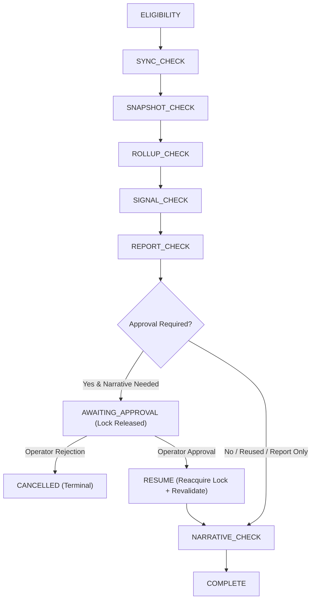

# BS-6 Production Intelligence Automation Architecture

## 1. Overview & Purpose

Phase **BS-6** establishes the production automation and deterministic scheduling foundation for BOP Social's multichannel intelligence pipeline.

Following Phase BS-5 (which proved manual, controlled operator execution of multi-platform rollups, cross-platform business signals, executive reporting, and grounded AI executive narratives), BS-6 constructs the orchestration and safety architecture required for scheduled, multi-tenant intelligence generation without prematurely activating autonomous recurring generation.

The intelligence pipeline follows a deterministic chain of progression:
```
Provider Sync ──► Metric Snapshots ──► Metric Rollups ──► Business Signals ──► Executive Report ──► Grounded Executive Narrative
```

Every stage in BS-6 is independently gated, strictly audited, tenant-isolated, idempotent, fail-closed, and safe against concurrent duplicate execution.

---

## 2. Core Architectural Invariants

1. **Explicit Tenant Unit**: Automation never executes globally without tenant enumeration. An automation unit is strictly defined as:
   $$\text{Automation Unit} = \text{Tenant (Client)} + \text{Reporting Period} + \text{Pipeline Version}$$
2. **Deterministic Execution Identity**: Every run derives its deduplication key via a SHA-256 digest of `client_id`, `period_start`, `period_end`, and `pipeline_version`.
3. **Database Unique Constraints**: Database-level unique constraints on active execution identities prevent duplicate inflight executions across distributed workers, covering `['PENDING', 'ELIGIBILITY_CHECK', 'RUNNING', 'AWAITING_APPROVAL']`.
4. **PostgreSQL Advisory Single-Flight Locking**: Fast, lightweight distributed mutual exclusion is maintained using PostgreSQL session advisory locks derived deterministically from the execution identity. Advisory locks are strictly released when pausing for human approval.
5. **Fail-Closed Eligibility**: Any unfulfilled safety invariant (e.g., inactive client, missing active credentials, stale telemetry, disabled config) halts execution cleanly without external provider calls or DB corruption.
6. **Existing Artifact Reuse**: If valid `ExecutiveReport` or `ExecutiveNarrative` records already exist for the requested period, the engine reuses them rather than regenerating or overwriting canonical data.
7. **Strict Provider Budget Enforcement**: Provider call budgets are strictly enforced (`budget = 1` by default, `0` in dry-run mode). Live LLM or social API calls are disallowed if the budget is exhausted.
8. **Pure Dry-Run Preview Mode**: Dry-run mode (`dry_run=True`) performs zero database mutations (no config edits, no run records, no report/narrative generation) and zero provider network calls, producing a comprehensive execution plan and diagnostic explanation.
9. **Observability Without Secret Leaking**: All audit events use structured JSON with automatic redaction of bearer tokens, client secrets, passwords, and private API keys.
10. **Disabled-by-Default Scheduler**: Recurring Celery Beat periodic tasks are registered as unscheduled/disabled until full production approval.
11. **Run-Level Approval Workflow (BS-6C)**: When operator approval is required before live narrative generation, the run transitions cleanly to `AWAITING_APPROVAL`, calculates a cryptographically frozen `approval_token`, releases session advisory locks, and halts before any external provider call. Resuming requires explicit operator decision, lock reacquisition, and complete safety revalidation.

---

## 3. Data Models

### 3.1 `IntelligenceAutomationConfig`

Tenant-level configuration governing pipeline scheduling, freshness thresholds, and safety limits.

| Field | Type | Default | Description |
|---|---|---|---|
| `client` | `OneToOneField(Client)` | Required | Foreign key to tenant client |
| `enabled` | `BooleanField` | `False` | Master switch for tenant automation |
| `timezone` | `CharField(64)` | `'America/New_York'` | Tenant timezone name |
| `reporting_frequency` | `CharField(20)` | `'MONTHLY'` | Schedule cadence (`MONTHLY`, `WEEKLY`, `CUSTOM`) |
| `reporting_day` | `PositiveSmallIntegerField` | `1` | Day of month (1-28) or weekday (0=Mon, 6=Sun) |
| `reporting_hour` | `PositiveSmallIntegerField` | `2` | Execution hour in tenant local time (0-23) |
| `lookback_days` | `PositiveIntegerField` | `30` | Data lookback duration |
| `minimum_data_freshness_hours` | `PositiveIntegerField` | `48` | Maximum telemetry staleness before blocking |
| `generate_report` | `BooleanField` | `True` | Whether to generate executive report |
| `generate_narrative` | `BooleanField` | `False` | Whether to generate AI grounded narrative |
| `require_operator_approval` | `BooleanField` | `True` | Enforce human-in-the-loop review |
| `provider_call_budget` | `PositiveIntegerField` | `1` | Max permitted external LLM calls per period |
| `max_retry_count` | `PositiveIntegerField` | `0` | Max automated retry attempts |

### 3.2 `IntelligenceAutomationRun`

Durable orchestration record tracking stage progression, execution identity, audit metadata, approval metadata, and artifact references.

| Field | Type | Description |
|---|---|---|
| `client` | `ForeignKey(Client)` | Associated tenant client |
| `agency_id` | `CharField(64)` | Agency identifier (supports UUIDs and string IDs) |
| `period_start` | `DateField` | Reporting period start boundary |
| `period_end` | `DateField` | Reporting period end boundary |
| `pipeline_version` | `CharField(32)` | Pipeline schema/algorithm version (default: `'bs6a-v1'`) |
| `execution_identity` | `CharField(64)` | SHA-256 hash of `(client_id, period_start, period_end, pipeline_version)` |
| `trigger_type` | `CharField(20)` | `MANUAL`, `SCHEDULED`, `RETRY`, or `ADMIN` |
| `status` | `CharField(20)` | `PENDING`, `ELIGIBILITY_CHECK`, `RUNNING`, `AWAITING_APPROVAL`, `BLOCKED`, `FAILED`, `COMPLETED`, `CANCELLED` |
| `current_stage` | `CharField(32)` | Currently executing or evaluated pipeline stage |
| `approval_status` | `CharField(20)` | `NOT_REQUIRED`, `PENDING`, `APPROVED`, `REJECTED` |
| `approval_requested_at`| `DateTimeField` | When the run transitioned to `AWAITING_APPROVAL` |
| `approval_decided_at` | `DateTimeField` | When operator recorded approval or rejection |
| `approved_by` | `ForeignKey(User)` | Operator who authorized or rejected the run |
| `approval_comment_safe`| `TextField` | Sanitized operator comment explaining the decision |
| `approval_token` | `CharField(64)` | SHA-256 identity freeze digest ensuring resume integrity |
| `started_at` | `DateTimeField` | Execution commencement timestamp |
| `finished_at` | `DateTimeField` | Execution conclusion timestamp |
| `requested_by` | `CharField(128)` | Username, task name, or system trigger |
| `dry_run` | `BooleanField` | Whether execution was executed as a dry-run |
| `provider_call_count` | `PositiveIntegerField` | Recorded number of external provider calls |
| `retry_count` | `PositiveIntegerField` | Current retry counter |
| `fallback_count` | `PositiveIntegerField` | Current fallback invocation counter |
| `error_code` | `CharField(64)` | Structured error or block code |
| `error_message_safe` | `TextField` | Sanitized, non-sensitive error explanation |
| `report_id` | `PositiveIntegerField` | ID of generated or reused `ExecutiveReport` |
| `narrative_id` | `PositiveIntegerField` | ID of generated or reused `ExecutiveNarrative` |

#### Unique Constraint (BS-6C)
```python
UniqueConstraint(
    fields=["execution_identity"],
    condition=Q(status__in=["PENDING", "ELIGIBILITY_CHECK", "RUNNING", "AWAITING_APPROVAL"]),
    name="unique_active_intelligence_run",
)
```
This ensures that an approval-pending run continues to hold execution uniqueness at the database level, preventing a second active run for the same execution identity across all 96 daily scheduler ticks.

---

## 4. Pipeline Stages & Approval Lifecycle

The pipeline defines nine sequential, inspectable stages including the human-in-the-loop approval pause:



1. **`ELIGIBILITY`**: Evaluates tenant active status, configuration presence, approval flags, credential presence, and existing lock states.
2. **`SYNC_CHECK`**: Validates whether recent provider sync logs exist within the configured staleness window (`minimum_data_freshness_hours`).
3. **`SNAPSHOT_CHECK`**: Verifies coverage of `SocialMetricSnapshot` records across active platforms for the period.
4. **`ROLLUP_CHECK`**: Verifies daily/weekly/monthly `SocialMetricRollup` records exist for cross-platform calculations.
5. **`SIGNAL_CHECK`**: Verifies deterministic `BusinessSignal` records exist or are evaluable for the period.
6. **`REPORT_CHECK`**: Reuses existing `ExecutiveReport` or prepares deterministic synthesis.
7. **`AWAITING_APPROVAL` (BS-6C)**: Pauses execution before any external provider call when `generate_narrative=True` and `require_operator_approval=True`. Calculates `approval_token`, transitions to `approval_status='PENDING'`, releases advisory lock, and stops safely.
8. **`NARRATIVE_CHECK`**: Reuses existing `VALIDATED` `ExecutiveNarrative` or checks LLM provider budget and approvals.
9. **`COMPLETE`**: Finalizes execution, updates duration, and releases locks.

---

## 5. Deterministic Period Calculator (`period.py`)

Reporting periods are calculated pure-functionally using timezone-aware calendar rules:
- **Tenant Timezone Aware**: Never relies on server UTC boundaries. Converts execution timestamps to tenant local time (e.g., `America/New_York`) prior to calculating start and end dates.
- **Calendar Month Mode (`MONTHLY`)**: Aligns with previous closed calendar months (e.g., execution on Oct 27 yields Sept 1 – Sept 30; execution on Nov 1 yields Oct 1 – Oct 31).
- **Rolling Window Mode**: Computes exact `[now - lookback_days, now]` intervals.
- **Weekly Mode (`WEEKLY`)**: Aligns with closed Monday–Sunday calendar weeks.
- **Daylight Saving Time (DST)**: Utilizes Python's `zoneinfo` module to correctly handle DST cutovers without boundary skew.

---

## 6. Measurable Freshness Engine (`freshness.py`)

Data freshness evaluates whether upstream platform syncs and snapshots are current enough for intelligence synthesis:

- **Metrics Evaluated**:
  - `active_credentials_count`: Number of active, unexpired platform OAuth credentials.
  - `last_sync_timestamp`: Most recent successful `SyncLog` across platforms.
  - `snapshots_in_period`: Total `SocialMetricSnapshot` rows within period boundaries.
  - `rollups_in_period`: Total `SocialMetricRollup` rows within period boundaries.
  - `age_hours`: Elapsed hours since the last successful sync.
- **Status Codes**:
  - `FRESH`: Data age is within `minimum_data_freshness_hours`.
  - `ACCEPTABLE`: Usable snapshots exist within lookback period.
  - `STALE`: Telemetry exceeds staleness threshold.
  - `NO_SYNC_LOGS`: No sync history recorded.
  - `NO_CREDENTIALS`: No active platform credentials found.

---

## 7. Pure Eligibility Engine & Safety Contract (`eligibility.py`)

A pure evaluation function `evaluate_intelligence_automation_eligibility(...)` inspects tenant state and produces an `EligibilityResult`.

### 7.1 Data Eligibility vs. Execution Authorization Semantics
To prevent ambiguous interpretations where `eligible=True` might be misconstrued as unrestricted execution permission, the engine explicitly distinguishes between:
1. **`data_eligible`**: Indicates whether upstream telemetry, platform credentials, metric snapshots, and period definitions are complete and sufficient for intelligence calculations.
2. **`execution_authorized`**: Indicates whether the execution has explicit operational authorization under its trigger context.
   - For `SCHEDULED` triggers: requires tenant configuration `enabled=True`.
   - For `MANUAL` / `ADMIN` triggers: requires active tenant and zero structural blockers.
3. **`status` / `eligible`**: Boolean composite indicator (`len(blocking_reasons) == 0`).
4. **`blocking_reasons`**: Deterministic list of unfulfilled gate codes.

### 7.2 Fail-Closed Checks
1. `CLIENT_INACTIVE`: Client model has `is_active=False`.
2. `CONFIG_MISSING`: No `IntelligenceAutomationConfig` exists for client (blocks `SCHEDULED`).
3. `AUTOMATION_DISABLED`: Config has `enabled=False` (blocks `SCHEDULED`).
4. `NO_CREDENTIALS`: Tenant has 0 active platform credentials.
5. `DATA_STALE`: Telemetry age exceeds `minimum_data_freshness_hours` on scheduled runs.
6. `INSUFFICIENT_DATA`: Zero snapshots found for the requested period.
7. `BUDGET_EXCEEDED`: Narrative requested but provider call budget is 0.

### 7.3 Artifact Reuse Logic
- Checks if `ExecutiveReport` already exists for `(client_id, period_start, period_end)`.
- Checks if `ExecutiveNarrative` already exists for `report_id` with `status="VALIDATED"`.
- If existing artifacts are found, the planned stages skip generation and flag `REUSE`.

---

## 8. Run-Level Approval & Controlled Resume Engine (BS-6C)

### 8.1 Approval Request Point & Lock Release Contract
Narrative stage pauses BEFORE any provider call:
1. When `generate_narrative=True` and `require_operator_approval=True`, `REPORT_CHECK` completes, linking any existing report or preparing report data.
2. The orchestrator transitions run status from `RUNNING` to `AWAITING_APPROVAL` with `approval_status='PENDING'`.
3. An SHA-256 identity freeze token is calculated and stored in `run.approval_token`:
   $$\text{approval\_token} = \text{SHA-256}(\text{run\_id} \mathbin{\Vert} \text{execution\_identity} \mathbin{\Vert} \text{pipeline\_version} \mathbin{\Vert} \text{period\_start} \mathbin{\Vert} \text{period\_end} \mathbin{\Vert} \text{report\_id})$$
4. `provider_call_count` is confirmed `0`.
5. The PostgreSQL session advisory lock is **explicitly released** before returning control. Worker threads and database connections do NOT retain locks while waiting for human input.
6. Execution terminates safely with stage `AWAITING_APPROVAL`. Zero LLM calls occur.

### 8.2 Operator Decision Protocol
An authorized operator or admin user records their decision via CLI (`approve_intelligence_run`), REST API, or Django Admin:
- **Approval (`approve_intelligence_run`)**:
  - Enclosed in an atomic transaction with `select_for_update()`.
  - Verifies run is currently in `AWAITING_APPROVAL` and `approval_status == 'PENDING'`.
  - Verifies operator permission (`is_staff`, `is_superuser`, or valid tenant operator role).
  - Verifies tenant isolation (operators cannot approve runs belonging to unauthorized clients).
  - Transitions `approval_status` to `'APPROVED'`, records `approved_by`, `approval_decided_at`, and `approval_comment_safe`.
  - Emits structured audit event `automation.approval.approved`.
- **Rejection (`reject_intelligence_run`)**:
  - Transitions run status directly to `CANCELLED` and `approval_status` to `'REJECTED'`.
  - Records operator ID, timestamp, and rejection reason.
  - Terminal state: no resume, no retry, no provider call.
  - Emits structured audit event `automation.approval.rejected`.
- **Double Approval Protection**:
  - If a run is already decided (`approval_status != 'PENDING'`), concurrent approval or rejection requests fail cleanly with `ApprovalStateError`.

### 8.3 Controlled Resume Contract (`resume_approved_intelligence_run`)
Resuming an approved run cannot assume conditions have remained unchanged during the human delay:
1. **Status Verification**: Confirms run status is `AWAITING_APPROVAL` and `approval_status == 'APPROVED'`.
2. **Lock Reacquisition**: Reacquires the PostgreSQL single-flight advisory lock. If another worker holds the lock, resume aborts cleanly with `CONCURRENCY_LOCK_ACTIVE`.
3. **Identity Freeze Verification**: Recomputes the SHA-256 approval token. If `execution_identity`, period boundaries, report ID, or pipeline version have drifted, resume aborts immediately with `ApprovalIdentityMismatchError`.
4. **Revalidation After Human Delay**: Reruns full safety gates:
   - Client must remain `is_active=True`.
   - Automation config must remain `enabled=True`.
   - Platform credentials must remain active.
   - Telemetry freshness must remain valid within staleness thresholds.
   - Provider call budget must not be exceeded.
5. **Existing Narrative Reuse**: If a `VALIDATED` `ExecutiveNarrative` already exists for the report, the resume service flags reuse without calling the provider.
6. **Provider Boundary (`PROVIDER_EXECUTION_READY`)**:
   - In Phase BS-6C, once an approved run passes all revalidations and reaches the narrative provider boundary, execution **halts deliberately**.
   - Result dictionary records `status='PROVIDER_EXECUTION_READY'`, `would_call_provider=True`, and `provider_call_count=0`.
   - **Zero live LLM calls (Ollama, OpenAI, Gemini, Anthropic) are executed.**

---

## 9. Observability & Safe Audit Logging (`events.py`)

All pipeline transitions produce structured audit events logged with structured JSON:
- **Event Types**:
  - `automation.run.started`
  - `automation.stage.transition`
  - `automation.eligibility.blocked`
  - `automation.approval.requested`
  - `automation.approval.approved`
  - `automation.approval.rejected`
  - `automation.approval.resumed`
  - `automation.run.blocked`
  - `automation.run.completed`
  - `automation.run.failed`
- **Secret Sanitization**:
  - Sensitive patterns (OAuth bearer tokens, access tokens, client secrets, API keys, passwords) are automatically scrubbed via regex matching before emission.

---

## 10. Operational Interface & Discovery Scanner

### 10.1 CLI Management Commands
```bash
# Dry-run inspection
python manage.py run_intelligence_automation --client 3 --dry-run --explain

# Run approval
python manage.py approve_intelligence_run --run 42 --comment "Approved for monthly delivery"

# Run rejection
python manage.py approve_intelligence_run --run 42 --reject --comment "Client requested delay"

# Resume approved run up to provider boundary
python manage.py approve_intelligence_run --run 42 --resume
```

### 10.2 Celery Task Architecture & Discovery Scanner (`tasks.py`)
- `discover_and_enqueue_due_intelligence_automations`: Periodic multi-tenant discovery scanner.
  - **Decoupled Due Engine**: Evaluates `is_tenant_due(config, reference_datetime)` and `calculate_next_due_datetime(config)`. The scanner operates on a global UTC cadence (every 15 minutes) and is completely decoupled from individual tenant local reporting hours.
  - **Missed-Tick Recovery**: If the scheduler is paused or restarts after downtime, any tenant whose threshold has arrived (`local_now >= due_threshold`) is immediately discovered and processed once for that reporting period, rather than skipped until the following month.
  - **Material Block State Idempotency & Reactivation (BS-6B.0B)**:
    - Instead of permanently skipping any period that has a historical `BLOCKED` row, the scanner computes a deterministic `block_state_hash` based on active blocking reasons, freshness codes, approval status, and configuration flags.
    - If a tenant's blocking condition remains unchanged (`block_state_hash == stored_hash`), the scanner skips re-enqueuing, eliminating runaway row storms across the 96 daily scanner ticks.
    - As soon as the material blocking state resolves (e.g. telemetry becomes fresh or operator approval is satisfied), the scanner detects the state change and immediately unlocks exactly ONE new attempt opportunity.
    - Prior terminal `BLOCKED` runs remain immutable audit records, and new attempts record an incrementing `attempt_number`.
  - **Active State Uniqueness**: The scanner explicitly skips tenants who have active runs in `['PENDING', 'ELIGIBILITY_CHECK', 'RUNNING', 'AWAITING_APPROVAL']`.

---

## 11. Verification Matrix

The test matrix validates all BS-6A through BS-6C invariants across 13 dedicated test modules:
1. `test_intelligence_automation_models.py` (Models, choices, defaults, active constraints)
2. `test_intelligence_automation_period.py` (Timezones, calendar boundaries, DST transitions)
3. `test_intelligence_automation_eligibility.py` (Fail-closed gates, freshness rules, budget limits)
4. `test_intelligence_automation_idempotency.py` (Deduplication, artifact reuse, identity stability)
5. `test_intelligence_automation_locking.py` (PostgreSQL advisory locking, collision handling)
6. `test_intelligence_automation_orchestration.py` (Stage progression, dry-run neutrality)
7. `test_intelligence_automation_security.py` (Tenant isolation, secret redaction)
8. `test_intelligence_automation_safety_contract.py` (Data eligibility vs authorization, force limits)
9. `test_intelligence_automation_scheduler_pilot.py` (Discovery scanner, cadence, due calculation, gate blocking)
10. `test_intelligence_automation_timezone_alignment.py` (Timezone conversion, DST spring/fall, missed-tick recovery, multi-timezone isolation, row-storm prevention)
11. `test_intelligence_automation_blocked_reactivation.py` (Material block state fingerprint, safe reactivation, attempt sequencing, 96-tick storm prevention)
12. `test_intelligence_automation_audit_immutability.py` (Row immutability, legacy dynamic derivation, monotonic attempt numbering, lock release/reacquisition on resume)
13. `test_intelligence_automation_approval_workflow.py` (BS-6C approval states, lock release on pause, reacquisition on resume, tenant authorization, double-approval protection, token freeze verification, revalidation delays, zero provider calls at provider boundary)

**Result**: 119 intelligence automation tests passed in 8.21s. Grounded narrative & multi-channel test suites: **213 passed** in 24.19s. Full backend test suite: **1,211 passed** with zero regressions (0 failures, 0 errors).
