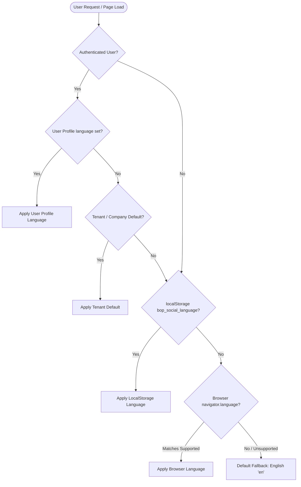

# Bop Social Internationalization (i18n) Architecture

## 1. Executive Summary

Bop Social is built from the core up to support multi-language capabilities across its marketing OS and workspace platform. Starting in **Phase BS-2.0**, Bop Social provides complete foundational support for **English (`en`)** and **Spanish (`es`)**.

- **English (`en`)** is the primary platform language, source of truth, and canonical fallback.
- **Spanish (`es`)** is supported across the foundational vertical slice (public navigation, authentication shell, login workflows, profile preferences) and serves as the architectural template for future phases.

---

## 2. Core Architectural Principles

1. **Strict Machine Contract Preservation**:
   - Machine keys, API endpoint routes, JSON schema attributes, database column names, third-party OAuth scopes (Meta, LinkedIn, YouTube, etc.), and error codes (`ERR_*`) are **never** translated.
   - Translation is strictly a presentation-layer concern.

2. **Language & Currency Decoupling**:
   - Currency display is completely independent from user interface language.
   - A Spanish-speaking user can view subscriptions or ad spend in `USD`, `EUR`, or `COP` without currency conversion assumptions.

3. **Multi-Tenant & Multi-User Preference Isolation**:
   - Authenticated user language is persisted in the database (`UserProfile.language`).
   - Anonymous language selections are persisted in `localStorage` under `bop_social_language`.
   - On logout or session revocation, credentials and active preferences are cleared to prevent cross-tenant or cross-user leakage.

---

## 3. Language Precedence Hierarchy

When a user visits Bop Social, the active language is resolved using the following order of precedence:



1. **User Explicit Preference**: Value stored in `UserProfile.language` (retrieved via `/api/auth/me/` or `/api/profile/`).
2. **Tenant / Company Default**: Organization-wide default configured for the workspace (if present).
3. **Anonymous Browser Storage**: `localStorage.getItem('bop_social_language')`.
4. **Browser Language Detection**: `navigator.language` (e.g. matching `es-*` -> `es`).
5. **Canonical Platform Fallback**: English (`en`).

---

## 4. Frontend Architecture

### 4.1 Technology Stack & Directory Structure
- **Engine**: `i18next` (`^23.x`) and `react-i18next` (`^14.x`).
- **Configuration**: `frontend/src/i18n/config.js`.
- **Locale Storage**:
  ```text
  frontend/src/locales/
  ├── en/
  │   ├── common.json        # Shared actions, status badges, global labels
  │   ├── navigation.json    # Navbar, mega-menus, drawer, footer
  │   └── auth.json          # Login, MFA, signup, password reset
  └── es/
      ├── common.json
      ├── navigation.json
      └── auth.json
  ```

### 4.2 Namespaces & Usage Guidelines
Translations are partitioned into modular namespaces to prevent bloated bundles and facilitate independent translation cycles:

| Namespace | Purpose | Example Keys |
| :--- | :--- | :--- |
| `common` | Shared buttons, statuses, confirmations, language labels | `actions.save`, `status.loading`, `languages.preferred_language` |
| `navigation` | Public top navbar, mega-menus, mobile drawer, footer | `nav.product`, `products.composer`, `footer.tagline` |
| `auth` | Sign-in, sign-up, MFA verification, auth layout copy | `login.title`, `login.email_label`, `mfa.code_label` |

#### React Component Usage:
```jsx
import { useTranslation } from 'react-i18next';

export default function MyComponent() {
  const { t } = useTranslation('navigation');
  return <button>{t('nav.sign_in', 'Sign in')}</button>;
}
```

---

## 5. UI Components: LanguageSelector

The `LanguageSelector` (`frontend/src/components/ui/LanguageSelector.jsx`) is a reusable, accessible component conforming to Bop Social design tokens:

- **Accessibility**:
  - Implements `aria-haspopup="listbox"`, `aria-expanded`, and ARIA `listbox` / `option` roles.
  - Complete keyboard navigation (`ArrowDown`, `ArrowUp`, `Enter`, `Space`, `Escape`, `Tab`).
- **Design Tokens**:
  - Automatically adapts between light and dark themes using CSS variables (`var(--surface-card)`, `var(--text-primary)`, `var(--border-subtle)`).
  - Supports a `darkHero` prop for transparent overlays on high-contrast hero backgrounds.
- **Integration Points**:
  - Desktop public navigation bar (beside `ThemeToggle`).
  - Mobile navigation drawer.
  - Authentication shell (`AuthLayout`).
  - User profile settings (`/account-settings`).

---

## 6. Locale-Aware Formatting Utilities

All formatting functions are centralized in `frontend/src/utils/formatters.js`:

```javascript
import { formatDate, formatTime, formatRelativeTime, formatNumber, formatPercent, formatCurrency } from '../utils/formatters';

// Dates & Times
formatDate(new Date(), { dateStyle: 'medium' }); // English: "Jun 15, 2026", Spanish: "15 jun 2026"
formatRelativeTime(twoHoursAgo);                  // English: "2 hours ago", Spanish: "hace 2 horas"

// Numbers & Percentages
formatNumber(1250000.5);                          // English: "1,250,000.5", Spanish: "1.250.000,5"
formatPercent(0.155, 1);                          // English: "15.5%", Spanish: "15,5 %"

// Decoupled Currency Formatting
formatCurrency(2500, 'USD', 'es');                // Spanish: "2500,00 US$"
formatCurrency(2500, 'EUR', 'en');                // English: "€2,500.00"
```

---

## 7. Backend Localization Architecture

### 7.1 Django Settings
In `backend/dashboard/settings.py`:
```python
LANGUAGE_CODE = 'en'
LANGUAGES = [
    ('en', 'English'),
    ('es', 'Spanish'),
]
USE_I18N = True
USE_TZ = True

MIDDLEWARE = [
    ...
    'django.contrib.sessions.middleware.SessionMiddleware',
    'django.middleware.locale.LocaleMiddleware',
    'django.middleware.common.CommonMiddleware',
    ...
]
```

### 7.2 Database & User Profile
The `UserProfile` model in `backend/social_stats/models.py` includes a safe, additive field:
```python
language = models.CharField(
    max_length=10,
    choices=[('en', 'English'), ('es', 'Spanish')],
    default='en',
)
```
- Migration: `0065_add_userprofile_language.py`.
- Exposing endpoints:
  - `GET /api/auth/me/` returns `'language'`.
  - `GET /api/profile/` returns `'language'`.
  - `PATCH /api/profile/` accepts `'language'` (`'en'` or `'es'`) and persists updates immediately.

---

## 8. Adding New Languages in Subsequent Phases

To add a new language (e.g. Portuguese `pt` or French `fr`) in future phases:

1. **Add Language Definition**:
   Update `SUPPORTED_LANGUAGES` in `frontend/src/i18n/config.js`:
   ```javascript
   { code: 'pt', label: 'Português', shortLabel: 'PT' }
   ```
2. **Create Locale Dictionaries**:
   Add `frontend/src/locales/pt/common.json`, `navigation.json`, `auth.json`.
3. **Register Backend Language**:
   Add `('pt', 'Portuguese')` to `LANGUAGES` in `backend/dashboard/settings.py` and `UserProfile.language` choices.

---

## 9. Phase BS-2.1 — Marketing & Authentication Translation Architecture

### 9.1 Overview & Scope
Phase BS-2.1 completes end-to-end Spanish and English bilingual support across Bop Social's entire public surface and authentication lifecycle:
- **Authentication Flows**: Sign-in, organization onboarding / sign-up, password reset, email verification, team invitation acceptance, end-user client portal onboarding, and OAuth callback error handling.
- **Transactional Communications**: Password reset emails and email verification communications delivered in the user's selected language.
- **Public Marketing Experience**: All 13 dedicated marketing pages, legal layouts, error/maintenance views, and data-driven marketing modules (Products, Solutions, Case Studies, Partner Agencies Showcase, and Blog).

### 9.2 Positioning & Brand Invariants
- **Brand Name**: `Bop Social` (never translated or altered).
- **Canonical Positioning Tagline**:
  - English: `Built for the Bop Universe`
  - Spanish: `Diseñado para el Universo Bop`
- **Machine Contract Preservation**:
  - Slugs (e.g. `/products/composer`, `/customers/urban-nest-realty`, `/blog/unified-marketing-os-is-here`), API routes, database fields, and error codes (`ERR_*`) remain canonical and untranslated.

### 9.3 Data-Driven Modular Companion Pattern
For content-heavy and structured marketing modules (products, solutions, case studies, agency directory, blog articles), Bop Social employs a **companion localization pattern**:
- **Canonical Structure**: English content and component metadata (Lucide icons, cover gradients, route anchors) reside in canonical files (`productPages.js`, `solutionPages.js`, `caseStudies.js`, `agencyProfiles.js`, `blogPosts.js`).
- **Localized Companions**: Complete Spanish content overrides reside in lightweight companion files:
  - `frontend/src/pages/marketing/productPages.es.js` (10 products)
  - `frontend/src/pages/marketing/solutionPages.es.js` (7 industry solutions)
  - `frontend/src/pages/marketing/caseStudies.es.js` (3 customer case studies)
  - `frontend/src/pages/marketing/agencyProfiles.es.js` (6 partner agency showcases)
  - `frontend/src/pages/marketing/blogPosts.es.jsx` (6 full-length blog articles with JSX body nodes)
- **Runtime Resolution**:
  Getter helpers (`getProductPage(slug, lang)`, `getSolutionPage(slug, lang)`, `getCaseStudy(slug, lang)`, `getAgency(slug, lang)`, `getPost(slug, lang)`, `getPosts(lang)`) inspect `i18n.language` and cleanly merge Spanish overrides while maintaining fallback to English.

### 9.4 Backend & Client Default Language
- **Organization Tenant Default**: Added `Client.default_language` (`CharField(max_length=10, choices=[('en', 'English'), ('es', 'Spanish')], default='en')`) via migration `0066_client_default_language_alter_mediaasset_file_and_more.py`.
- **Transactional Email Localization**:
  `auth_views._send_verification_email` and `auth_views._send_reset_email` resolve the recipient's language preference (`user.profile.language` or `client.default_language`) and render localized email subject lines, greeting, body instructions, and button labels.

---

## 10. Phase BS-2.1.1 — Translation Coverage Closure & Migration 0066 Audit

### 10.1 Root-Cause Analysis of Browser Inspection Defects
During user verification of BS-2.1 on `http://localhost:3010/`, inspection revealed that the homepage hero and login panels were rendering in English even when Spanish was selected:
1. **Docker Container Stale Image**:
   - `docker ps -a` inspection showed that `agencyos-frontend-1` and `agencyos-backend-1` were running images built 41 hours prior, tagged `bs-2.0` (`bopsocial-frontend-local:bs-2.0`). At commit `b207c02` (BS-2.0), `HomePage.jsx` and `AuthLayout.jsx` were hardcoded English.
   - The user's browser was accessing the stale `bs-2.0` container because compose had not forced an image rebuild with fresh tags.
2. **Uncovered Code Gaps in BS-2.1**:
   - `LoginPage.jsx`: Hardcoded `"or continue with"`, `"local only · password demo"`, and demo account role labels (`Superadmin`, `Agency`, `End user`).
   - `AuthLayout.jsx`: `es/auth.json` retained `"eyebrow": "Marketing OS"` instead of `"Sistema Operativo de Marketing"`.
   - `PasswordStrength.jsx`: Hardcoded `"Password strength: ..."` meter label and level names.
   - `EndUserSignupPage.jsx`: Hardcoded industry options and Step 3 summary review labels.
   - `HomePage.jsx`: Floating hero cards (`NotificationCard`, `CampaignMetricCard`, `LeadCapturedCard`, `AIPopupCard`) contained static strings.
   - `BentoPreviews.jsx`: Interactive mock copy across all 8 bento cards contained static English strings.

### 10.2 Database Migration 0066 Comprehensive Audit
File: `backend/social_stats/migrations/0066_client_default_language_alter_mediaasset_file_and_more.py`.

- **Internationalization Operations**:
  - `AddField('client', 'default_language')`: Adds the tenant default language column (`models.CharField(max_length=10, choices=[('en', 'English'), ('es', 'Spanish')], null=True, blank=True)`).
  - `AlterField('userprofile', 'language')`: Alters `UserProfile.language` to allow `null=True, blank=True, default=None`, enabling fallback to tenant default when unset.
- **Bundled Non-i18n Operations**:
  - `AlterField('mediaasset', 'file')` and `AlterField('mediaasset', 'thumbnail')`: Bundled automatically because `models.py` referenced `upload_to=media_asset_upload_path` without a previous migration.
  - **Schema Impact Assessment**: In PostgreSQL, these fields remain standard `varchar` paths. There was zero change to underlying database column types, constraints, or table structure. The migration is strictly backward-compatible with zero migration failure risk.

### 10.3 Precedence Formalization & Automated Test Suite
The backend preference hierarchy (`User Preference` -> `Tenant Default` -> `Platform Default 'en'`) was formalized and verified across 10 comprehensive tests in `backend/social_stats/tests/test_language_preferences.py`:
1. `test_user_preference_overrides_tenant_default`: Explicit user preference wins over company default.
2. `test_tenant_default_applies_when_user_has_no_preference`: Company default applies when user has no explicit language.
3. `test_user_preference_persists_across_sessions`: Updates to user profile language persist.
4. `test_default_fallback_to_english`: Canonical English fallback when neither is set.
5. `test_anonymous_user_uses_default`: Unauthenticated requests receive canonical fallback.
6. `test_invalid_language_code_fallback`: Unsupported codes gracefully fall back.
7. `test_multi_tenant_isolation`: Verifies that language preference does not leak between tenant workspaces.
8. `test_existing_users_without_language_behave_as_unset`: Verifies backward compatibility for existing records.
9. `test_switching_between_authorized_tenants`: Switching tenant context resolves the active tenant's default.
10. `test_transactional_email_locale_resolution`: Transactional email sender renders localized templates based on recipient preference.

### 10.4 Frontend Coverage Implementation & Verification
- **Catalog Synchronization**:
  - `es/auth.json`: Added `or_continue_with`, `demo_local_notice`, `demo_password_label`, `demo_role_*`, updated `auth_layout.eyebrow` to `"Sistema Operativo de Marketing"`, and added complete `password_strength` and `end_user_signup` dictionaries.
  - `en/marketing.json` & `es/marketing.json`: Added `home.hero_float_*` keys and `bento_preview` blocks covering all 8 interactive previews.
- **Component Updates**:
  - `LoginPage.jsx`: All demo labels, notices, and divider text wired to `t()`.
  - `PasswordStrength.jsx`: Translated meter label and levels.
  - `EndUserSignupPage.jsx`: Dynamic translation for industry options and summary review fields.
  - `HomePage.jsx`: Floating hero cards dynamically translated.
  - `BentoPreviews.jsx`: Interactive mock copy wired to `t('bento_preview.*')`.
- **Regression Tests**:
  - `frontend/src/i18n/__tests__/i18n.test.js`: Verified 5/5 test suites covering BS-2.1.1 keys in English and Spanish.
  - `frontend/src/pages/__tests__/LoginPageTranslation.test.jsx`: Verified 3/3 tests confirming full Spanish rendering of `LoginPage` and `PasswordStrength`.
- **Docker Deployment**:
  - Tagged local images `bopsocial-frontend-local:bs-2.1.1` and `bopsocial-backend-local:bs-2.1.1` in `docker-compose.local.yml`.
  - Executed `docker compose up -d --build frontend backend` and verified healthy containers running live on `http://localhost:3010/`.

---

## 11. Phase BS-2.2 — Bop Social Dashboard & Application Shell Translation

### 11.1 Architectural Scope and Namespace Strategy
Phase BS-2.2 extended the English/Spanish internationalization architecture into the authenticated Bop Social application shell, core navigation, main client dashboard, agency admin overview, and user settings.
English remains the canonical fallback, and Spanish is fully functional across the defined shell and dashboard scope.
Internal slugs, permissions, database keys, routes, and brand invariants (`Bop Social`) remain strictly intact.

Four dedicated namespaces structure the translation assets:
1. `app.json`: Shell navigation, module rail, feature sidebar sections and items, top bar, mobile drawer & navigation, command palette, notification bell, client switcher, and realtime notifications.
2. `dashboard.json`: Client dashboard (greeting, highlights, quick links, KPI metrics for YouTube, Facebook, Instagram, Google My Business, and general platforms, platform breakdown table, upcoming posts, and brand profile strip) and agency overview (hero command center, signals, summary bar, performance snapshot, operational detail, monthly goal manager, smart alerts, top posts panel, and ROI summary panel).
3. `settings.json`: User settings page header, tab group titles (Account, Workspace, Developer, Privacy), tab labels, and profile tab fields, hints, and feedback messages.
4. `common.json`: Reusable UI elements (`accept`, `reject`, `from`, `to`, `soon`).

### 11.2 Shell and Navigation Integration
- **`ModuleRail.jsx`**:
  - Localized brand home aria-label, module button labels and tooltips (with localized `Soon` pill), bottom action buttons (`Notifications`, `Settings`), and `UserMenu` actions.
  - Safe default array handling for `modules = []` to prevent runtime regressions during asynchronous module loading.
- **`FeatureSidebar.jsx`**:
  - Dynamic module header and section title translation via `t('sidebar.sections.<key>')` and `t('sidebar.items.<key>')`.
  - Localized client switcher toggle and search inputs.
- **`TopBar.jsx` & `AppShell.jsx`**:
  - Integrated `<LanguageSelector size="sm" />` beside `ThemeToggle` in both desktop `TopBar` and `MobileTopBar`.
  - Localized dynamic breadcrumb generator (`buildBreadcrumbs`) mapping route segments through `app` catalog keys with graceful fallback.
  - Localized command palette search trigger, what's new pill, mobile drawer title, and realtime toasts.
- **`MobileNav.jsx`**:
  - Localized primary mobile navigation bar (`Home`, `Calendar`, `Reports`, `Alerts`, etc.).
- **`CommandPalette.jsx`**:
  - Localized input placeholders, search loading states, empty results, category group headers (`Recent`, `Pages`, `Quick actions`, `Clients`, `Help & resources`, `Posts`, `Leads`, `Conversations`, `Contacts`), keyboard navigation hints, and quick action labels.
- **`NotificationBell.jsx`**:
  - Localized dropdown title, unread badges, mark-all-read action, tab switchers (`Alerts`, `Notifications`), empty states, and invitation actions (`Accept`, `Reject`).
- **`DateRangePicker.jsx`**:
  - Localized date bounds labels (`From`, `To`) using `common` namespace.

### 11.3 Dashboard & Settings Localization
- **`ClientDashboard.jsx`**:
  - Localized page header, greeting, highlight cards, quick action links, control bar quick stats (`Connected`, `Posts`, `Data`) with dynamic status badges (`Live`, `Waiting`).
  - Standardized KPI cards across all platform views (YouTube, Facebook, Instagram, Google My Business, Default) referencing localized metric labels from `dashboard.json`.
  - Platform breakdown table headers dynamically mapped via `dashboard:breakdown.headers.*`.
  - Collapsible brand profile strip translated (`Brand Profile ▼`, `Hide ▲`, `About`, `USP`, `Target Audience`, `Subcategories`).
  - Upcoming posts widget and empty state notices translated.
- **`AdminOverview.jsx`**:
  - Agency command center hero panel copy, signal cards (`Active Users`, `Top Platform`, `Click Efficiency`, `Sync Health`), and summary bar items.
  - Performance snapshot stat cards and operational tables (`Platform Performance`, `Recent Sync Activity`).
  - Embedded panels: `GoalManager`, `AlertsPanel`, `TopPostsPanel`, and `ROIOverviewPanel` completely wired to `dashboard:admin.*` keys with localized table headers and actions.
- **`UserSettingsPage.jsx`**:
  - Localized page header, sidebar tab groups (`Account`, `Workspace`, `Developer`, `Privacy`) and tab items.
  - Complete `ProfileTab` localization: photo upload hints, name and email labels, email immutability disclaimer, language selection radio controls, validation messages, and save button states.

### 11.4 Verification and Deployment
- **Automated Regression Test Suites**:
  - `frontend/src/components/shell/__tests__/AppShellTranslation.test.jsx`: 4/4 passing tests verifying English default rendering, dynamic switching to Spanish, `LanguageSelector` integration in `TopBar`, and localized module items in `FeatureSidebar`.
  - `frontend/src/pages/__tests__/DashboardTranslation.test.jsx`: 3/3 passing tests verifying key resolution across `app`, `dashboard`, and `settings` namespaces in English and Spanish, and `UserSettingsPage` Spanish rendering.
  - Frontend test suite execution: **14/14 test suites passed, 71/71 tests passed**.
  - Backend test suite execution: **10/10 tests passed** in `social_stats.tests.test_language_preferences`.
  - Production build: `npm run build` completed cleanly with exit code 0.
- **Container Deployment**:
  - Image tag updated in `docker-compose.local.yml`: `bopsocial-frontend-local:bs-2.2`.
  - Container recreated and started: `bopsocial-frontend-local:bs-2.2` built and running.
  - Live HTTP health check: `curl.exe --max-time 10 -I http://localhost:3010/` returned **HTTP/1.1 200 OK** from Nginx.

---

## 12. Phase BS-2.2.1 — Dashboard Translation & Locale Formatting Closure

### 12.1 Defect Closure Overview
During authenticated inspection of `/admin/analytics/dashboard` as local superadministrator, specific dynamic messages, empty states, and date displays were identified as remaining in English when Spanish was selected. Phase BS-2.2.1 closed these gaps without redesigning the dashboard or altering internal database entities or routes:

1. **"No data yet"**:
   - Replaced hardcoded fallback in `AdminOverview.jsx` with `t('admin.no_data_yet', 'No data yet')` ("Sin datos todavía" in Spanish).
2. **"Waiting for synced performance data"**:
   - Replaced hardcoded string in top platform SignalCard with `t('admin.waiting_for_synced_data', 'Waiting for synced performance data')` ("Esperando datos de rendimiento sincronizados" in Spanish).
3. **"0 active platforms in this window"**:
   - Wired to `t('admin.active_platforms_count', { count: activePlatforms })` supporting i18next pluralization (`_one` / `_other`). Translates to `"0 plataformas activas en este período"` in Spanish.
4. **"0 clicks from 0 impressions"**:
   - Wired to `t('admin.clicks_from_impressions', { clicks: fmt(totalClicks), impressions: fmt(totalImpressions) })` with localized metric interpolation. Translates to `"0 clics de 0 impresiones"` in Spanish.
5. **"No recent syncs"**:
   - Replaced hardcoded fallback in `AdminOverview.jsx` and summary bar with `t('admin.no_recent_syncs', 'No recent syncs')` ("Sin sincronizaciones recientes" in Spanish). In addition, sync status tokens (`success`, `failed`, `running`, `queued`) are translated dynamically via `t('admin.sync_status.<status>')`.
6. **Date Formatting Defect (`2026-08-25 to 2026-09-24`)**:
   - Replaced `${overview.period.since} to ${overview.period.until}` with `formatDateRange(overview.period.since, overview.period.until, { dateStyle: 'medium' }, i18n?.language)`.
   - In English: renders `"Aug 25 – Sep 24, 2026"`.
   - In Spanish: renders `"25 ago – 24 sept 2026"`.

### 12.2 Locale Formatting Infrastructure
- **`frontend/src/utils/formatters.js`**:
  - Implemented `parseDateSafe(val)` to safely parse `YYYY-MM-DD` date strings into local date objects, avoiding negative UTC midnight offset date shifting.
  - Implemented `formatDateRange(startDate, endDate, options, locale)` utilizing native `Intl.DateTimeFormat.prototype.formatRange` with graceful fallback for older runtimes.
  - Updated `formatDate` to use `parseDateSafe`.
- **`frontend/src/i18n/formatters.js`**:
  - Created canonical export mapping forwarding all formatters from `../utils/formatters`.

### 12.3 Verification & Deployment
- **Dedicated Automated Test Suite**:
  - `frontend/src/pages/__tests__/AdminOverviewTranslationClosure.test.jsx`: 4/4 passing tests verifying English default rendering of all 6 reported states, full Spanish rendering upon switching language, runtime language switching without reload, and populated overview metrics invariance.
  - `frontend/src/utils/__tests__/formatters.test.js`: Added date range tests across English and Spanish (7/7 tests passed).
- **Full Frontend Test Suite**:
  - **15 / 15 test suites passed, 76 / 76 tests passed**.
- **Production Build**:
  - `npm run build` completed cleanly with exit code 0.
- **Docker Deployment**:
  - Image tag updated in `docker-compose.local.yml`: `bopsocial-frontend-local:bs-2.2.1`.
  - Rebuilt and started container: `agencyos-frontend-1` running `bopsocial-frontend-local:bs-2.2.1`.
  - HTTP health check verified: `curl.exe --max-time 10 -I http://localhost:3010/` returned **HTTP/1.1 200 OK**.
  - Direct login verification on port 3010 verified: `LOGIN_CHECK: SUCCESS, has_access=True`.


